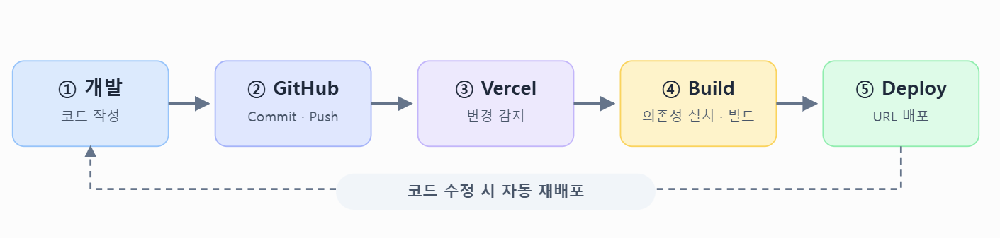

# Claude Code

## 설치 및 환경 준비
### 1. Claude Code 설치

1. https://code.claude.com/docs/ko/quickstart#step-1-install-claude-code에 접속합니다.

Claude Code를 설치하려면 터미널을 열고 시스템에 맞는 명령을 실행하십시오.

▶ [window powershell일 경우]
```powershell
irm https://claude.ai/install.ps1 | iex
```
설치 명령은 Claude Code를 다운로드하는 동안 진행 상황을 표시하지 않습니다. 설치 프로그램이 완료되면 새 터미널 창을 열고 claude --version을 실행하십시오. 

```bash
claue --version
```

설치가 제대로 되었으면 버전 번호가 출력됩니다. 셸에서 claude를 찾을 수 없거나 인식되지 않는다고 표시되면 설치 디렉토리가 아직 PATH에 없는 것입니다.

[참고] 실행파일의 설치경로는 일반적으로 다음과 같다.

```bash
C:\Users\사용자계정\.local\bin\claude.exe
```


### 2. VS Code 설치

VS Code(Visual Studio Code)는 Microsoft에서 제공하는 무료 코드 편집기로, 다양한 프로그래밍 언어를 지원하며 Git, GitHub, Claude Code 등 AI 개발 도구와 연동할 수 있습니다.

#### 2-1. VS Code 다운로드

1. VS Code 공식 홈페이지에 접속합니다.
   - https://code.visualstudio.com/
2. **Download for Windows** 버튼을 클릭합니다.
3. Windows용 설치 파일(`VSCodeUserSetup-x64.exe` 등)을 다운로드합니다.
4. 다운로드한 설치 파일을 실행합니다.

#### 2-2. VS Code 설치

1. 설치 프로그램을 실행합니다.
2. 사용권 계약에 동의합니다.
3. 설치 경로는 기본값을 사용합니다.
4. 시작 메뉴 폴더는 기본값을 사용합니다.
5. **추가 작업 선택** 화면에서 다음 항목을 선택합니다.

| 설정 항목 | 권장 여부 | 설명 |
|---|---|---|
| 바탕 화면 바로 가기 만들기 | 선택 | 바탕 화면에서 VS Code 실행 |
| PATH에 추가 | 필수 권장 | 터미널에서 `code` 명령어 사용 |
| 파일 탐색기에서 Code로 열기 | 권장 | 파일을 우클릭하여 VS Code 실행 |
| 디렉터리 탐색기에서 Code로 열기 | 권장 | 폴더를 우클릭하여 VS Code 실행 |
| 지원되는 파일 형식의 편집기로 등록 | 권장 | 코드 파일을 VS Code로 열기 |

6. **설치(Install)** 버튼을 클릭합니다.
7. 설치가 완료되면 VS Code를 실행합니다.

#### 2-3. VS Code 설치 확인

**1. PowerShell 실행**

Windows 시작 메뉴에서 PowerShell을 실행합니다.

**2. 설치 확인**

```powershell
code --version
```

실행 결과 예시:

```text
1.xx.x
...
x64
```

버전 정보가 출력되면 정상적으로 설치된 것입니다.

※ `code` 명령어가 인식되지 않으면 PowerShell을 다시 실행하거나 PATH 설정을 확인합니다.


#### 2-4. VS Code 기본 환경 설정

**1. 한국어 언어팩 설치 (선택)**

1. VS Code를 실행합니다.
2. 왼쪽 Extensions(확장) 메뉴를 클릭합니다.
3. 검색창에 `Korean Language Pack`을 입력합니다.
4. **Korean Language Pack for Visual Studio Code**를 설치합니다.
5. 안내에 따라 VS Code를 다시 실행합니다.

**2. 자동 저장 설정**

1. 상단 메뉴에서 `File → Auto Save`를 선택합니다.
2. 파일 수정 내용이 자동으로 저장되도록 설정합니다.

**3. 기본 터미널 설정**

1. 상단 메뉴에서 `Terminal → New Terminal`을 선택합니다.
2. 터미널 오른쪽의 드롭다운 메뉴에서 `Select Default Profile`을 선택합니다.
3. **PowerShell**을 기본 터미널로 설정합니다.

**4. Python 확장팩 설치(필수)**

1. 왼쪽 Extensions(확장) 메뉴를 클릭합니다.
2. 검색창에 `Python`을 입력합니다.
3. Microsoft에서 제공하는 **Python** 확장 프로그램을 선택합니다.
4. **Install** 버튼을 클릭합니다.
5. 설치가 완료되면 Python 코드 작성, 자동 완성, 디버깅 기능을 사용할 수 있습니다.

- 확장 프로그램: `Python`
- 제공자: Microsoft
- Extension ID: `ms-python.python`

※ Python 확장 프로그램과 Python 실행 환경은 별개이므로 Python 인터프리터도 설치해야 합니다.

**5. Claude Code 확장 프로그램 설치**

1. 왼쪽 Extensions(확장) 메뉴를 클릭합니다.
2. 검색창에 `Claude Code`를 입력합니다.
3. Anthropic에서 제공하는 **Claude Code** 확장 프로그램을 선택합니다.
4. **Install** 버튼을 클릭합니다.
5. 설치 후 Claude 계정으로 로그인합니다.
6. VS Code에서 Claude Code를 이용하여 AI 기반 코딩 작업을 수행할 수 있습니다.

- 확장 프로그램: `Claude Code`
- 제공자: Anthropic
- Extension ID: `anthropic.claude-code`

※ Claude Code 사용을 위해서는 계정 인증과 이용 가능한 요금제 또는 API 사용 환경이 필요합니다.

**6. Jupyter 확장팩 설치**

1. 왼쪽 Extensions(확장) 메뉴를 클릭합니다.
2. 검색창에 `Jupyter`를 입력합니다.
3. Microsoft에서 제공하는 **Jupyter** 확장 프로그램을 선택합니다.
4. **Install** 버튼을 클릭합니다.
5. 설치 후 `.ipynb` 파일을 생성하고 Python 코드를 셀 단위로 실행할 수 있습니다.
6. 노트북 실행 시 사용할 Python 커널을 선택합니다.

- 확장 프로그램: `Jupyter`
- 제공자: Microsoft
- Extension ID: `ms-toolsai.jupyter`

※ Jupyter 확장 프로그램 설치와 별도로 실행 가능한 Python 환경 및 `ipykernel` 패키지가 필요할 수 있습니다.

**7. 확장 프로그램 설치 확인**

VS Code 터미널에서 다음 명령어를 실행합니다.

```powershell
code --list-extensions
```

설치된 확장 프로그램 목록에서 다음 항목을 확인합니다.

```text
ms-ceintl.vscode-language-pack-ko
ms-python.python
anthropic.claude-code
ms-toolsai.jupyter
```

**8. 설치 확장 프로그램 요약**

| 확장 프로그램 | 제공자 | 주요 기능 |
|---|---|---|
| Korean Language Pack | Microsoft | VS Code 한국어 UI 지원 |
| Python | Microsoft | Python 코드 작성, 자동 완성 및 디버깅 |
| Claude Code | Anthropic | AI 기반 코드 생성, 수정 및 개발 지원 |
| Jupyter | Microsoft | Python 노트북 실행 및 데이터 분석 |

> **참고**
> - Python: Python 프로그래밍 실습
> - Claude Code: AI 기반 바이브 코딩 및 프로젝트 개발
> - Jupyter: 데이터 분석, 머신러닝 및 AI 모델 실습
> - 확장 프로그램은 VS Code의 기능을 추가하며, 실제 실행 환경은 별도로 설치해야 할 수 있습니다.


#### 2-5. 프로젝트 폴더 열기

**1. 프로젝트 폴더 생성**

PowerShell에서 다음 명령어를 실행합니다.

```powershell
mkdir todo-ai-native
cd todo-ai-native
```

**2. VS Code 실행**

```powershell
code .
```

현재 폴더를 VS Code에서 엽니다.

#### 2-6. VS Code 주요 기능

| 기능 | 단축키 | 설명 |
|---|---|---|
| 터미널 열기 | Ctrl + ` | 명령어 실행 |
| 명령 팔레트 | Ctrl + Shift + P | VS Code 명령 검색 및 실행 |
| 파일 탐색기 | Ctrl + Shift + E | 프로젝트 파일 관리 |
| 확장 프로그램 | Ctrl + Shift + X | 개발 도구 설치 |
| 소스 제어 | Ctrl + Shift + G | Git 변경사항 확인 |
| 파일 검색 | Ctrl + P | 파일 이름으로 빠르게 검색 |
| 전체 검색 | Ctrl + Shift + F | 프로젝트 전체 내용 검색 |

#### 2-7. 최종 설치 확인

VS Code 터미널에서 다음 명령어를 실행합니다.

```powershell
# VS Code 버전 확인
code --version

# 현재 작업 경로 확인
pwd

# 현재 폴더의 파일 목록 확인
dir
```

정상적으로 실행되면 VS Code 개발 환경 구성이 완료된 것입니다.

> **참고**
> - VS Code는 코드 작성과 프로젝트 관리를 위한 편집기입니다.
> - Git은 소스코드의 변경 이력을 관리합니다.
> - GitHub는 Git 저장소를 온라인에서 관리하는 서비스입니다.
> - Claude Code는 터미널에서 실행하여 AI 기반 코드 작성과 개발 작업을 수행할 수 있습니다.


#### 2-8. PowerShell 스크립트 실행 권한 설정

Windows에서 VS Code 터미널을 사용할 때 `npm`, `Claude Code` 등의 명령어 실행이 차단되는 경우 PowerShell의 실행 정책을 변경할 수 있습니다.

**1. VS Code 터미널 실행**

1. VS Code를 실행합니다.
2. 상단 메뉴에서 `Terminal → New Terminal`을 선택합니다.
3. 기본 터미널이 `PowerShell`인지 확인합니다.

**2. 현재 사용자에게 스크립트 실행 허용**

powershell(터미널)에서 다음 명령어를 실행합니다.

```powershell
Set-ExecutionPolicy -Scope CurrentUser RemoteSigned
```

---
### 3. Git 설치

Git은 소스코드의 변경 이력을 관리하는 버전 관리 도구입니다. GitHub와 연결하면 작성한 코드를 온라인에 저장하고 다른 개발자와 협업할 수 있습니다.

#### 3-1. Git 다운로드

1. Git 공식 홈페이지에 접속합니다.
   - https://git-scm.com/downloads/win
2. **Git for Windows** 설치 파일을 다운로드합니다.
3. 다운로드한 `.exe` 파일을 실행합니다.

또다른 방법(powershell에서)
```powershell
winget install --id Git.Git -e --source winget
```

#### 3-2. Git 설치

1. 설치 프로그램을 실행합니다.
2. 설치 경로는 기본값을 사용합니다.
3. 기본 편집기는 **Visual Studio Code**를 선택할 수 있습니다.
4. PATH 환경 설정은 권장 기본값을 사용합니다.
5. 나머지 설정은 기본값으로 진행합니다.
6. **Install** 버튼을 클릭하여 설치를 완료합니다.

#### 3-3. Git 설치 확인

VS Code에서 터미널을 실행합니다.

- 메뉴: `Terminal → New Terminal`
- 단축키: `Ctrl + Shift + ``

다음 명령어를 입력합니다.

```bash
git --version
```

실행 결과 예시:

```text
git version 2.x.x.windows.1
```

버전 정보가 출력되면 Git이 정상적으로 설치된 것입니다.

#### 3-4. Git 사용자 정보 설정(중요)

Git에서 Commit을 생성할 때 사용할 `이름`과 `이메일을 등록`합니다.
- Git계정과 동일하게

```bash
# 사용자 이름 설정
git config --global user.name "사용자이름"

# 사용자 이메일 설정
git config --global user.email "example@gmail.com"
```

설정 확인:

```bash
git config --global --list
```

실행 결과 예시:

```text
user.name=사용자이름
user.email=example@gmail.com
```

※ 이메일은 GitHub 계정에 등록된 이메일 또는 GitHub에서 제공하는 비공개 이메일을 사용할 수 있습니다.

#### 3-5. GitHub CLI 설치 (PR 실습용)

GitHub CLI는 터미널에서 GitHub의 Pull Request(PR)를 생성하고 병합할 수 있도록 지원하는 도구입니다.

```
[참고]
Pull Request(PR) : GitHub에서 내가 작업한 브랜치의 변경사항을 다른 브랜치에 합쳐 달라고 요청하는 기능
```

**1. Windows PowerShell 실행**

VS Code 터미널에서 PowerShell을 선택합니다.

**2. GitHub CLI 설치**

```powershell
winget install --id GitHub.cli -e
```

설치가 완료되면 터미널을 다시 실행(★★★★)합니다.

**3. 설치 확인**

```bash
gh --version
```

**4. GitHub 로그인**

```bash
gh auth login
```

로그인 과정에서 다음 항목을 선택합니다.

1. GitHub.com
2. HTTPS
3. 웹 브라우저를 이용한 로그인
4. 브라우저에서 GitHub 계정 인증 완료

**5. 로그인 확인**

```bash
gh auth status
```

GitHub 계정 인증 정보가 출력되면 정상적으로 연결된 것입니다.

#### 3-6. 최종 설치 확인

다음 명령어를 실행합니다.

```bash
# Git 설치 확인
git --version

# Git 사용자 정보 확인
git config --global --list

# GitHub CLI 설치 확인
gh --version

# GitHub 인증 확인
gh auth status
```

위의 명령어가 정상적으로 실행되면 Git과 GitHub CLI를 사용할 준비가 완료된 것입니다.

> **참고**
> - `git`: 소스코드 버전 관리, Commit, Push, Merge 수행
> - `gh`: GitHub 로그인, PR 생성, PR 검토 및 병합 수행
> - GitHub CLI는 Git과 별도로 설치해야 합니다.
> - 기존 GitHub 저장소가 있다면 새 저장소를 만들 필요가 없습니다.


### 4. Next.js 설치

Next.js는 `React 기반의 웹 애플리케이션 개발 프레임워크`입니다. 웹 화면(Frontend)과 서버 기능(Backend API)을 하나의 프로젝트에서 개발할 수 있습니다.

#### 4-1. Node.js 설치

Next.js를 사용하려면 먼저 Node.js가 설치되어 있어야 합니다.

**1. Node.js 다운로드(필수)**

1. Node.js 공식 홈페이지에 접속합니다.
   - https://nodejs.org/
2. **LTS(Long Term Support)** 버전을 선택합니다.
3. Windows용 설치 파일(`.msi`)을 다운로드합니다.
4. 설치 파일을 실행합니다.
5. 기본 설정을 유지하고 설치를 완료합니다.
6. VS Code 터미널을 다시 실행합니다.

**2. Node.js 설치 확인(필수)**

VS Code에서 `Terminal → New Terminal`을 선택한 후 다음 명령어를 실행합니다.

```powershell
# Node.js 버전 확인
node -v

# npm 버전 확인
npm -v
```

- `node`: JavaScript 실행 환경
- `npm`: JavaScript 패키지 설치 및 관리 도구

※ Next.js 최신 버전은 Node.js 20.9 이상이 필요하므로, 최신 LTS 버전 사용을 권장합니다.

#### 4-2. Next.js 프로젝트 생성(선택)

Next.js는 일반적으로 전역 설치하지 않고 프로젝트를 생성하면서 필요한 패키지를 설치합니다.

**1. 프로젝트를 생성할 폴더로 이동**

```powershell
cd Desktop
```

※ 바탕 화면 경로가 다른 경우 원하는 작업 폴더로 이동합니다.

**2. Next.js 프로젝트 생성**

```powershell
npx create-next-app@latest my-next-app
```

- `npx`: npm 패키지를 실행하는 명령어
- `create-next-app`: Next.js 프로젝트 생성 도구
- `my-next-app`: 생성할 프로젝트 폴더 이름

**3. 프로젝트 생성 옵션 선택**

설치 과정에서 다음과 같은 질문이 나타날 수 있습니다.

| 설정 항목 | 권장 선택 | 설명 |
|---|---|---|
| TypeScript | Yes | JavaScript에 타입 검사 기능 추가 |
| ESLint | Yes | 코드 오류 및 품질 검사 |
| React Compiler | No | 입문 실습에서는 선택 사항 |
| Tailwind CSS | Yes | CSS 스타일링 지원 |
| `src/` directory | Yes | 소스코드를 src 폴더에서 관리 |
| App Router | Yes | Next.js 최신 라우팅 구조 사용 |
| Import alias | No | 기본 경로 별칭 사용 |

※ 질문 항목과 기본값은 Next.js 버전에 따라 달라질 수 있습니다.

#### 4-3. 프로젝트 실행

**1. 프로젝트 폴더로 이동**

```powershell
cd my-next-app
```

**2. VS Code에서 프로젝트 열기**

```powershell
code .
```

**3. 개발 서버 실행**

```powershell
npm run dev
```

실행 결과 예시:

```text
▲ Next.js
- Local: http://localhost:3000

✓ Ready
```

**4. 웹 브라우저에서 확인**

다음 주소에 접속합니다.

http://localhost:3000

Next.js 기본 화면이 나타나면 설치 및 실행이 정상적으로 완료된 것입니다.

※ 개발 서버를 종료하려면 터미널에서 `Ctrl + C`를 누릅니다.

#### 4-4. Next.js 프로젝트 구조

App Router와 `src/` 디렉터리를 선택한 경우의 기본 구조입니다.

```text
my-next-app/
│
├── public/                 # 이미지 등 정적 파일
├── src/
│   └── app/
│       ├── layout.tsx      # 공통 화면 레이아웃
│       ├── page.tsx        # 메인 페이지
│       └── globals.css     # 전역 CSS
│
├── package.json            # 프로젝트 패키지 및 실행 명령
├── next.config.ts          # Next.js 설정
├── tsconfig.json           # TypeScript 설정
└── node_modules/           # 설치된 라이브러리
```

#### 4-5. Next.js 주요 명령어

| 명령어 | 기능 |
|---|---|
| `npx create-next-app@latest my-next-app` | Next.js 프로젝트 생성 |
| `npm install` | 프로젝트 의존성 패키지 설치 |
| `npm run dev` | 개발 서버 실행 |
| `npm run build` | 배포용 프로젝트 빌드 |
| `npm run start` | 빌드된 프로젝트 실행 |
| `npm run lint` | 린트 스크립트가 정의된 경우 코드 검사 |
| `Ctrl + C` | 실행 중인 서버 종료 |

#### 4-6. Next.js 실행 확인 실습

**실습 목표: 메인 페이지에 "Hello Next.js" 출력하기**

1. VS Code에서 `src/app/page.tsx` 파일을 엽니다.
2. 기존 코드를 다음 코드로 변경합니다.

```tsx
export default function Home() {
  return (
    <main>
      <h1>Hello Next.js!</h1>
      <p>나의 첫 번째 Next.js 웹 애플리케이션</p>
    </main>
  );
}
```

3. 파일을 저장합니다.
4. 브라우저에서 `http://localhost:3000`에 접속합니다.
5. 수정된 화면이 자동으로 반영되는지 확인합니다.

#### 4-7. 최종 설치 확인

```powershell
# Node.js 설치 확인
node -v

# npm 설치 확인
npm -v

# 현재 프로젝트의 Next.js 버전 확인
npm list next

# Next.js 개발 서버 실행
npm run dev
```

정상적으로 실행되면 Next.js 개발 환경 구성이 완료된 것입니다.

> **참고**
> - Node.js: JavaScript 실행 환경
> - npm: 패키지 관리 도구
> - React: 사용자 인터페이스(UI) 개발 라이브러리
> - Next.js: React 기반 웹 애플리케이션 프레임워크
> - TypeScript: 타입 검사를 지원하는 JavaScript 확장 언어
> - Tailwind CSS: 유틸리티 클래스 기반 CSS 프레임워크


---
### 5. Vercel로 배포하기
- 배포란 내컴퓨터에서 만든 서비스를 인터넷에 올려서 누구나 접근할 수 있게 만든 과정
- 버셀은 `웹 사이트와 웹 애플리케이셔을 인터넷에 올려서 운영해주는 클라우드 플랫폼`입니다.

- 버셀은 배포 과정을 단순하게 처리해주는데, `특히 깃허브 저장소와 직접 연결해서 코드를 자동으로 배포`해주는 기능이 가장 강력하다.



- Hobby(무료) : 상업적 사용불가, 개인 프로젝트 가능
- Pro($20/월) : 상업적 사용가능, 팀 협업
- Enterprose(별도문의) : 대규모 서비스용


#### 5-1. Vercel에 GitHub 저장소 연결하기

Vercel은 GitHub에 저장된 웹 프로젝트를 연결하여 자동으로 빌드하고 인터넷에 배포하는 클라우드 플랫폼입니다.

예를 들어 GitHub에 Next.js 프로젝트를 Push하면 Vercel이 변경사항을 감지하고 자동으로 배포할 수 있습니다.
---
[prompt방법]
```prompt
현재 GitHub 저장소 `first_work2`는 `frontend(React + Vite)`와 `backend(FastAPI)`로 구성되어 있어.

이 저장소 하나를 Vercel에 연결하여 Frontend와 Backend를 함께 배포하고 싶어.

1. 현재 프로젝트 구조를 분석해 줘.
2. Vercel에서 하나의 GitHub 저장소와 하나의 웹사이트 주소로 배포할 수 있는 구성을 제안해 줘.
3. 필요한 설정 파일과 코드를 작성해 줘.
4. Frontend에서 Backend API를 정상적으로 호출하도록 연결해 줘.
5. Supabase 환경변수와 보안 설정을 확인해 줘.
6. 로컬 빌드와 테스트를 수행해 줘.
7. 배포에 필요한 GitHub Commit 및 Push를 진행해 줘.

기존 기능은 유지하고, 변경사항과 Vercel에서 직접 설정해야 하는 항목을 알려줘.
```


---
###### 1. 전체 연결 과정

```text
VS Code / 로컬 Git
       │
       │ 코드 작성 → Commit → Push
       ▼
GitHub 저장소
       │
       │ GitHub 연동
       ▼
Vercel
       │
       │ 자동 빌드 및 배포
       ▼
웹 서비스 접속
https://my-next-app.vercel.app
```

###### 2. GitHub 저장소 연결 절차

**1. Vercel 접속**

1. Vercel 공식 홈페이지에 접속합니다.
   - https://vercel.com
2. **Sign Up / Log In**을 클릭합니다.
3. GitHub 계정으로 로그인합니다.

**2. 새 프로젝트 생성**

1. Vercel Dashboard에 접속합니다.
2. **Add New → Project**를 선택합니다.
3. **Import Git Repository** 화면으로 이동합니다.

**3. GitHub 저장소 연결**

1. GitHub 계정을 연결합니다.
2. GitHub에서 Vercel의 저장소 접근 권한을 승인합니다.
3. 배포할 GitHub 저장소를 선택합니다.
4. **Import** 버튼을 클릭합니다.

※ GitHub 저장소가 나타나지 않으면 **Adjust GitHub App Permissions**에서 해당 저장소에 대한 접근 권한을 허용합니다.

**4. 프로젝트 배포**

1. 프로젝트 설정을 확인합니다.
2. **Deploy** 버튼을 클릭합니다.
3. 빌드 및 배포가 완료될 때까지 기다립니다.
4. 배포된 웹사이트 주소로 접속합니다.

###### 3. 프로젝트 설정

GitHub 저장소를 가져오면 Vercel에서 프로젝트의 빌드 환경을 설정합니다.

| 설정 항목 | Next.js 프로젝트 | React + Vite 프로젝트 |
|---|---|---|
| Framework Preset | Next.js | Vite |
| Root Directory | `./` | `frontend` |
| Build Command | 기본값 사용 | `npm run build` |
| Output Directory | 기본값 사용 | `dist` |
| Production Branch | `main` 권장 | `main` 권장 |

※ React + Vite 프로젝트가 `frontend/` 폴더에 있는 경우 Root Directory를 `frontend`로 지정합니다.

###### 4. 환경변수 설정 (Supabase 사용 시)

Supabase와 같은 외부 서비스를 사용하는 경우 Vercel에 환경변수를 등록해야 합니다.

**1. 환경변수 설정 화면 이동**

1. Vercel Dashboard에서 프로젝트를 선택합니다.
2. **Settings → Environment Variables**로 이동합니다.
3. 필요한 환경변수를 등록합니다.

**2. Next.js + Supabase 환경변수 예시**

```env
NEXT_PUBLIC_SUPABASE_URL=실제_Supabase_URL
NEXT_PUBLIC_SUPABASE_PUBLISHABLE_KEY=실제_Publishable_Key
```

**3. React + Vite 환경변수 예시**

```env
VITE_SUPABASE_URL=실제_Supabase_URL
VITE_SUPABASE_PUBLISHABLE_KEY=실제_Publishable_Key
```

※ 주의사항

- `NEXT_PUBLIC_`: Next.js에서 브라우저에 공개되는 환경변수
- `VITE_`: Vite에서 브라우저에 공개되는 환경변수
- Supabase `service_role` 키는 브라우저에 노출하면 안 됩니다.
- 비밀키는 서버 환경에서만 사용해야 합니다.
- 환경변수를 변경한 후에는 새로 배포해야 적용됩니다.

###### 5. GitHub Push 시 자동 배포

GitHub 저장소와 Vercel을 연결하면 이후 Push 및 Merge 작업에 따라 자동으로 배포됩니다.

| GitHub 작업 | Vercel 동작 |
|---|---|
| `feature/todo-init` Push | Preview 배포 |
| `develop` Push | Preview 배포 |
| PR 생성 | 변경사항 미리보기 및 검증 |
| `main`에 Merge | Production 배포 |
| `main`에 Push | Production 배포 |

※ Production Branch가 `main`으로 설정되어 있고 Git 자동 배포가 활성화되어 있다는 전제입니다.

**브랜치별 배포 구조**

```text
로컬 Git
   │
   ├── feature/todo-init
   │         │
   │         └── Push → Vercel Preview
   │
   ├── develop
   │         │
   │         └── Push → Vercel Preview
   │
   └── main
             │
             └── Push → Vercel Production
                              │
                              ▼
                       실제 웹 서비스
```

###### 6. 기존 Vercel 프로젝트에 GitHub 연결하기

이미 Vercel 프로젝트가 있다면 새 프로젝트를 생성하지 않고 기존 프로젝트에 GitHub 저장소를 연결할 수 있습니다.

1. Vercel Dashboard에 접속합니다.
2. 기존 프로젝트를 선택합니다.
3. **Settings → Git**으로 이동합니다.
4. **Connected Git Repository** 항목을 확인합니다.
5. GitHub 저장소를 연결하거나 기존 연결 상태를 확인합니다.
6. Production Branch 설정을 확인합니다.

###### 7. GitHub 변경사항 Push 및 배포 확인

**1. VS Code에서 변경사항 Commit**

```bash
git add .
git commit -m "feat: 기능 업데이트"
```

※ Commit 전에 `.env`, API Key 등 민감정보가 포함되지 않았는지 확인합니다.

**2. GitHub에 Push**

```bash
git push origin main
```

**3. Vercel 배포 확인**

1. Vercel Dashboard에서 프로젝트를 선택합니다.
2. **Deployments** 메뉴를 클릭합니다.
3. 최신 배포 상태를 확인합니다.
4. 배포가 완료되면 웹사이트에 접속합니다.

###### 8. 전체 작업 흐름 정리

| 단계 | 작업 | 설명 |
|---|---|---|
| 1 | GitHub 연결 | Vercel과 GitHub 저장소 연동 |
| 2 | 프로젝트 설정 | Framework, Root Directory 설정 |
| 3 | 환경변수 등록 | Supabase 등 외부 서비스 연결 |
| 4 | Deploy | 최초 웹 서비스 배포 |
| 5 | Commit | 로컬 코드 변경사항 기록 |
| 6 | Push | GitHub에 변경사항 업로드 |
| 7 | Auto Deploy | Vercel이 변경사항을 자동 빌드 및 배포 |
| 8 | Verify | 배포된 웹사이트 정상 동작 확인 |

###### 9. 핵심 정리

**GitHub와 Vercel은 한 번 연결하면 이후 자동 배포가 가능합니다.**

```text
코드 수정
   ↓
Git Commit
   ↓
Git Push
   ↓
GitHub 저장소 업데이트
   ↓
Vercel 자동 빌드
   ↓
Vercel 자동 배포
   ↓
웹사이트 업데이트
```

> **참고**
> - Git: 로컬 소스코드 버전 관리
> - GitHub: 원격 저장소 및 협업 관리
> - Vercel: 웹 애플리케이션 빌드 및 배포
> - Preview: 개발 중인 기능을 미리 확인하는 배포 환경
> - Production: 실제 사용자에게 제공하는 운영 환경
>
> React + Vite + FastAPI + Supabase 구조에서는 프론트엔드를 Vercel에 배포할 수 있으며, FastAPI 백엔드는 별도의 서버리스 함수 구성이나 백엔드 호스팅 설정이 필요합니다.

