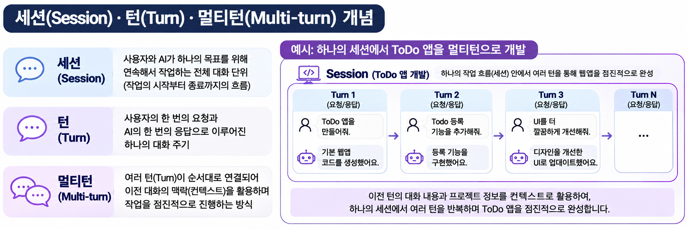
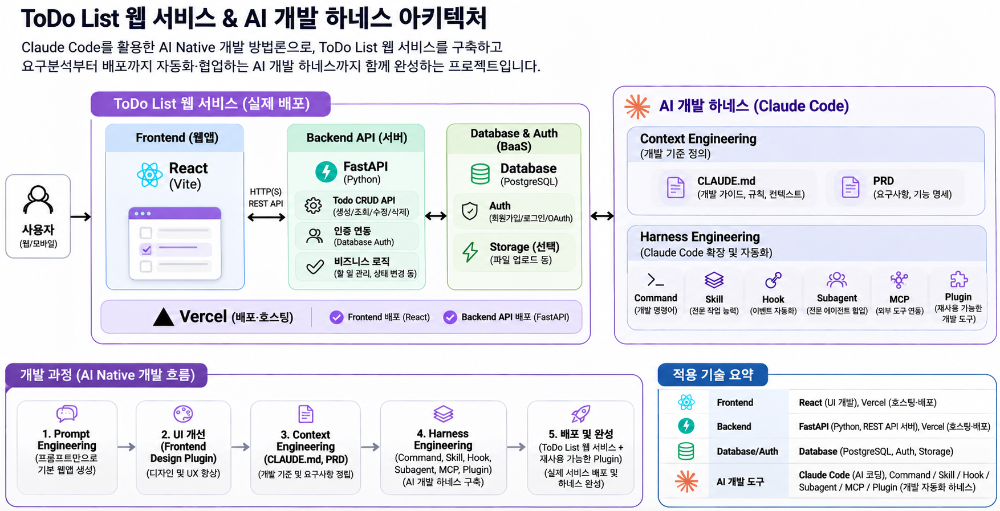
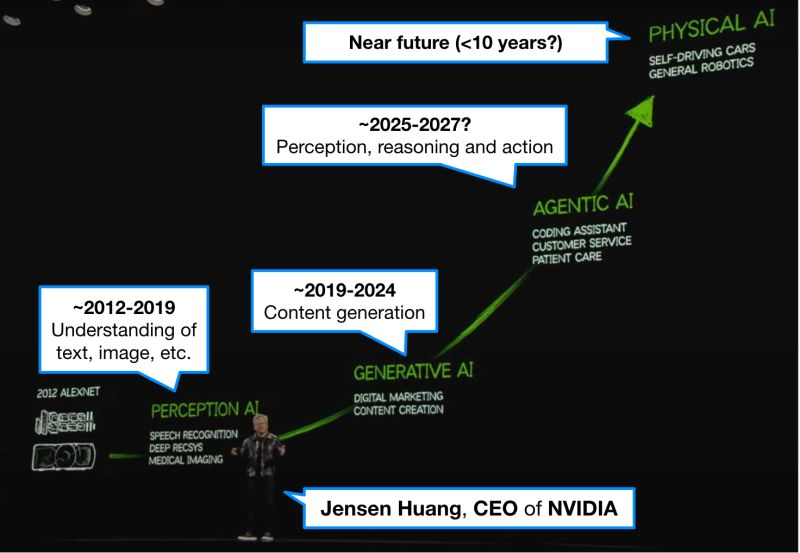
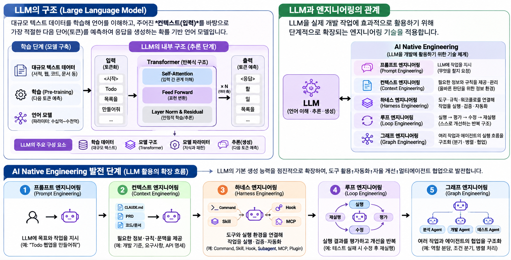
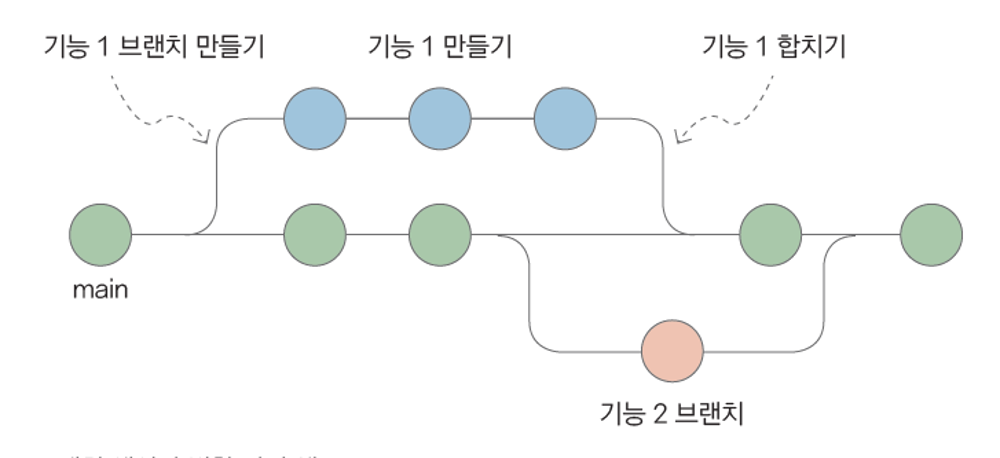
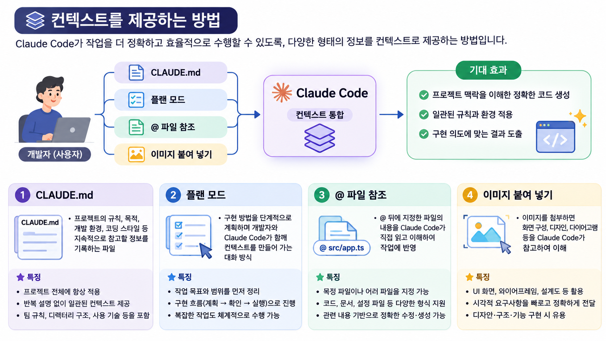

# Claude Code 기반 AI Native Engineering - ToDo List 웹앱 개발 교육과정

# 1. 교육과정 개요
> Vibe Coding → Frontend Design → Context Engineering → SDD → Harness Engineering → Agentic Development

## 1-1. 교육 목표
```
본 교육은 Claude Code를 활용하여 하나의 `ToDo List 웹 애플리케이션을 단계적으로 완성`하면서 `AI Native 소프트웨어 개발 방법론`을 학습하는 프로젝트 중심 실습 과정입니다.

AI Native 소프트웨어 개발 방법론은 **prompt engineering →Context Engineering→Harness Engineering→Loop Engineering→Graph Engineering**의 형태로 발전했다.

처음에는 프롬프트만으로 웹앱을 생성(prompt engineering)하고, Frontend Design Plugin으로 UI를 개선합니다.

이때, 하나의 Session에서 여러 Turn을 반복하면서 ToDo 앱을 점진적으로 완성하며, `이전 대화와 프로젝트 정보`를 `Context로 활용하여 일관된 개발 작업을 수행`해야 하므로,

이후 CLAUDE.md와 PRD를 활용해 개발 기준(Context Engineering)을 명확히 하고, AI가 Code Agent로 진화하면서 이를 활용하여 Command, Skill, Hook, Subagent, MCP, Plugin(Harness Engineering)을 순차적으로 적용합니다.
```
---

> #### ▶ 세션(Session), 턴(Turn), 멀티턴(Multi-turn) 개념

| 용어 | 정의 | Claude Code 활용 예시 |
|---|---|---|
| **Session (세션)** | 사용자와 AI가 하나의 작업 흐름을 이어가는 대화 단위 | Claude Code를 실행하여 ToDo 앱 개발 작업 진행 |
| **Turn (턴)** | 사용자 요청과 이에 대한 AI의 응답으로 이루어진 한 번의 대화 주기 | "ToDo 앱을 만들어줘" → AI가 코드 생성 |
| **Multi-turn (멀티턴)** | 여러 Turn이 연결되어 이전 대화의 맥락을 활용하는 방식 | 앱 생성 → 기능 추가 → UI 수정 → 오류 해결 |
| **Context (컨텍스트)** | AI가 현재 작업을 수행할 때 참고하는 정보 | 이전 대화, CLAUDE.md, 소스 코드, 실행 결과 |
| **Context Window (컨텍스트 윈도우)** | LLM이 한 번의 처리 과정에서 참고할 수 있는 토큰 범위 | 대화가 길어지면 컨텍스트 압축이 필요할 수 있음 |



**※하나의 Session에서 여러 Turn을 반복하면서 ToDo 앱을 점진적으로 완성하며, `이전 대화와 프로젝트 정보`를 `Context로 활용하여 일관된 개발 작업을 수행`합니다.**

---

▶  최종적으로 다음 두 가지 결과물을 완성합니다.

1. **ToDo List 웹 서비스**
   - React + FastAPI + Supabase + Vercel 기반
   - 실제 배포 가능한 웹 애플리케이션

2. **AI 개발 하네스**
   - 요구사항 분석
   - 기능 구현
   - 테스트 및 자동 검증
   - 전문 에이전트 협업
   - 외부 도구 연동
   - 재사용 가능한 Claude Code Plugin
---
### 개발 목표 아키텍처



## 1-2. 전체 교육 로드맵
- 최근에는 `Vibe Coding`이라는 용어 대신 `AI Native Engineering`이라고들 표현한다.
- **AI 네이티브 엔지니어링(AI Native Engineering)** AI에게 작업을 지시하는 단계에서 출발하여, AI가 스스로 도구를 활용하고, 실행 결과를 검증·개선하며, 여러 에이전트가 협업하도록 발전하는 개발 패러다임입니다.

**[참고] AI기술트랜드**




**[참고] Agent(=LLM+환경)의 동작원리**


- **핵심**: AI Agent는 단순히 답변을 생성하는 것이 아니라, **목표 이해 → 계획 → 도구 실행 → 결과 검증을 반복**하여 목표를 달성합니다.


**[참고] LLM과 에이전트**



### AI 네이티브 엔지니어링(AI Native Engineering)의 기술 발달 단계

| 단계 | 핵심 기술 | 정의 및 역할 | 발전 방향 |
|---|---|---|---|
| 1 | **프롬프트 엔지니어링 (Prompt Engineering)** | AI에게 무엇을 해야 하는지 목표와 작업을 지시합니다. | **AI 활용의 시작** |
| 2 | **컨텍스트 엔지니어링 (Context Engineering)** | AI가 올바르게 판단하고 작업하도록 필요한 정보와 규칙을 제공·관리합니다. | **AI Agent의 지능적 판단 기반** |
| 3 | **하네스 엔지니어링 (Harness Engineering)** | AI가 정해진 절차에 따라 도구를 활용하고 작업을 수행·검증하도록 실행 환경을 구성합니다. | **AI 작업의 체계화·자동화** |
| 4 | **루프 엔지니어링 (Loop Engineering)** | 실행 결과를 평가 → 오류 수정 → 재실행하는 과정을 반복하여 목표한 품질에 도달하도록 개선합니다. | **AI 작업의 자율적 개선** |
| 5 | **그래프 엔지니어링 (Graph Engineering)** | 여러 작업과 에이전트의 실행 흐름·조건부 분기·병렬 처리·상태 전이를 구조화합니다. | **멀티에이전트 협업 및 오케스트레이션** |


[**컨텍스트 엔지니어링(Context Engineering)과 AI Agent의 관계**]
```markdown
- **컨텍스트 엔지니어링(Context Engineering)**은 `AI Agent(멀티턴을 가진 LLM)가 작업을 수행하는 데 필요한 정보를 적절한 시점에 제공하고 관리하는 핵심 기술`입니다.

- LLM이 컨텍스트를 바탕으로 응답을 생성한다면, AI Agent는 컨텍스트를 바탕으로 **판단하고, 도구를 선택하고, 작업을 수행하며, 다음 행동을 결정**합니다.

- 즉, 컨텍스트 엔지니어링은 **AI Agent가 올바르게 행동할 수 있도록 정보 환경을 설계하는 기술**이라고 볼 수 있습니다.
```

### Phase 1. 프롬프트 엔지니어링(Prompt)기반 Vibe Coding
: AI에게 무엇을 해야 하는지 목표와 작업을 지시
- Git 및 Branch
- Prompt Engineering
- React 기본 UI 생성
- Frontend Design Plugin
- 반응형 UI 개선

### Phase 2. Context Engineering & SDD
: AI가 올바르게 판단하고 작업하도록 필요한 정보와 규칙을 제공·관리, 도구 및 MCP를 활용
- Context Engineering
- CLAUDE.md
- PRD 작성
- API 및 DB 명세
- 수용 기준 정의
- MCP

### Phase 3. Full-stack Development
- Monorepo
- React + FastAPI
- REST API
- Supabase PostgreSQL
- Vercel 배포

### Phase 4. Harness Engineering
: Command, Skill, Hook, Subagent 기술과 실행 결과 검증 및 피드백 루프 기술을 추가해서 유기적으로 연결하여 AI의 실행·검증·수정 과정을 관리하는 AI Agent 서비스를 개발하면 AI가 코드를 생성하는 수준을 넘어, `정해진 규칙과 절차에 따라 작업하고 검증`하도록 `실행 환경을 구성`할 수 있는 하네스가 된다.

- Command
- Skill
- Hook
- Subagent

### Phase 5. Agentic Development(제외)
- Custom Plugin
- 통합 검증
- AI 개발 하네스 완성

---
실행 환경 구축

[환경구축](0교시_setup.md)


## 1-3. 교육 운영 계획

### 1-3-1. 교육 개요

| 항목 | 내용 |
|---|---|
| 교육명 | Claude Code 기반 AI Native ToDo List 개발 |
| 총 교육시간 | 8시간 |
| 전체 모듈 | 13개 |
| 모듈별 시간 | 2시간 |
| 실습 비중 | 약 70% |
| 교육 방식 | 프로젝트 기반 실습 |
| 최종 결과물 | ToDo 서비스 + Claude Code Plugin |

### 1-3-2. 기술 스택

| 구분 | 사용 기술 |
|---|---|
| AI 개발 | Claude Code |
| IDE | VS Code |
| 버전 관리 | Git, GitHub |
| 프론트엔드 | React, Vite, JavaScript |
| 디자인 | Frontend Design Plugin |
| 백엔드 | Python, FastAPI |
| 데이터베이스 | Supabase PostgreSQL |
| 배포 | Vercel |
| API 테스트 | Pytest, Swagger UI |
| E2E 테스트 | Playwright |
| 개발 자동화 | Command, Skill, Hook |
| 에이전트 | Claude Code Subagent |
| 외부 도구 | MCP |
| 패키징 | Claude Code Plugin |

### 1-3-3. 전체 교과목 편성표

| 모듈 | 교과목 | 핵심 기술 | 시간 |
|---|---|---|---|
| 1 | 개발 환경 및 프로젝트 관리 | Claude Code, Git, Branch | 
| 2 | 프롬프트 기반 UI 개발 | Prompt Engineering, React | 
| 3 | Frontend Design Plugin | Frontend Plugin, UI/UX |
| 4 | Context Engineering | CLAUDE.md, Context |
| 5 | 요구사항 및 설계 | PRD, SDD, API Spec | 
| 6 | 풀스택 앱 구현 | Monorepo, React, FastAPI |
| 7 | DB 연동 및 배포 | Supabase, Vercel |
| 8 | Command 기반 개발 | Custom Slash Command | 
| 9 | Skill 기반 개발 | SKILL.md, References |
| 10 | Hook 자동 검증 | Hook, ESLint, Ruff |
| 11 | Subagent 기반 개발 | Planner, Developer, Reviewer | 
| 12 | MCP 기반 도구 연동 | GitHub, Supabase, Playwright | 
| 13 | Custom Plugin 및 최종 평가 | Plugin, Harness |


---


# 2. Claude Code

## 2-1. Claude Code란?

- Anthropic에서 개발한 `AI 기반 코딩 에이전트(AI Coding Agent)`
- `자연어 명령`을 통해 `코드 생성, 수정, 실행, 테스트 등의 소프트웨어 개발 작업을 수행하는 도구`
- 개발자가 직접 코드를 작성하지 않아도 AI와 대화하면서 애플리케이션 개발 가능
- 단순히 코드를 추천하는 AI가 아니라, 프로젝트의 파일을 읽고 수정하며 명령어를 실행할 수 있는 `에이전트형 개발 도구`
- Claude Code에서는 도구 실행 단계에서 파일 읽기·수정, 코드 작성, 터미널 명령 실행, 테스트 등이 이루어집니다.

### 2-1-1. Claude 제품군 비교

Anthropic의 Claude 제품군을 **일반 사용자용 AI 챗봇, 개발자용 코딩 에이전트, API 기반 개발 서비스**로 구분하여 비교하면 다음과 같습니다.

| 구분 | Claude (웹/앱) | Claude Code | Claude API |
|---|---|---|---|
| 주요 목적 | AI 대화 및 업무 지원 | AI 기반 소프트웨어 개발 | AI 기능을 애플리케이션에 통합 |
| 주요 사용자 | 일반 사용자, 기획자 | 개발자, 비개발자 | AI 서비스 개발자 |
| 사용 환경 | 웹, 모바일, 데스크톱 | CLI, IDE, 웹 등 | API, SDK |
| 사용 방식 | 채팅 기반 자연어 요청 | 자연어 기반 에이전트 작업 | 프로그램에서 API 호출 |
| 코드 생성 | 코드 작성 및 설명 | 프로젝트 코드 생성 및 수정 | 코드 생성 기능 구현 가능 |
| 파일 접근 | 업로드 및 연결된 파일 중심 | 권한이 허용된 프로젝트 파일 접근 | 개발자가 파일 접근 기능 구현 |
| 명령어 실행 | 실행 환경과 도구에 따라 제한적 | 터미널 명령어 실행 가능 | 별도 실행 환경 및 도구 연동 필요 |
| 테스트 | 코드 분석 및 실행 환경에 따른 테스트 | 테스트 실행 및 오류 수정 | 테스트 자동화 기능 구현 가능 |
| 에이전트 기능 | 지원 기능 및 연결 도구에 따라 활용 | 개발 작업을 위한 에이전트 기능 내장 | 에이전트 시스템 직접 구현 가능 |
| 대표 활용 | 문서 작성, 분석, 질의응답 | 웹앱 개발, 디버깅, 리팩토링 | 챗봇, RAG, AI Agent 개발 |

**핵심 차이점**

- **Claude:** AI를 직접 사용하는 서비스
- **Claude Code:** AI가 개발 도구를 활용하여 실제 코딩 작업을 수행하는 서비스
- **Claude API:** Claude 모델을 자신의 프로그램이나 서비스에 연결하는 개발 인터페이스

세 제품은 서로 다른 AI 모델을 의미하는 것이 아니라, **Claude 모델을 활용하는 방식과 제공 기능이 다른 제품 및 개발 인터페이스**입니다.

---

## 2-2. Claude Code의 주요 특징

### 2-2-1. 자연어 기반 개발

- 프로그래밍 언어 대신 자연어로 개발 작업 지시
- 사용자의 요구사항을 분석하여 필요한 코드를 생성
- 기존 코드를 이해하고 기능을 추가하거나 수정

예시:

"React를 이용하여 Todo List 웹 애플리케이션을 만들어줘."

### 2-2-2. 프로젝트 파일 관리

- 프로젝트의 폴더와 파일 구조 분석
- 새로운 파일 및 디렉터리 생성
- 기존 소스 코드 수정 및 리팩토링
- 여러 파일에 걸친 기능 변경 수행

### 2-2-3. 터미널 명령어 실행

- 개발 환경의 터미널 명령어 실행
- 필요한 패키지 설치
- 애플리케이션 빌드 및 테스트 실행
- 오류 메시지를 분석하여 수정 작업 수행

### 2-2-4. 에이전트 기반 작업 수행

- 사용자의 목표를 분석하고 작업 계획 수립
- 필요한 도구를 선택하여 실행
- 실행 결과를 확인하고 오류를 수정
- 목표 달성을 위해 여러 작업을 반복 수행

---

## 2-3. Claude Code의 동작 구조

### 2-3-1. 기본 동작 과정

1. 사용자 요청
   - 자연어로 개발 목표와 요구사항 전달

2. `컨텍스트` 수집
   - 프로젝트 파일 및 디렉터리 분석
   - `CLAUDE.md의 개발 규칙 확인`
   - 관련 소스 코드와 문서 참조

3. `작업 계획`
   - 요구사항 분석
   - 필요한 작업과 수정 대상 결정
   - 작업 순서 및 실행 방법 수립

4. `도구 실행`
   - 파일 읽기 및 수정
   - 코드 생성
   - 터미널 명령어 실행
   - 테스트 수행

5. `결과 검증 및 수정`
   - 실행 결과와 오류 확인
   - 필요한 코드 수정
   - 테스트 재실행

6. 작업 결과 보고
   - 변경된 파일과 주요 기능 설명
   - 테스트 결과 및 남은 문제 보고

### 2-3-2. Claude Code의 핵심 실행 구조

```text
사용자 요청
    ↓
Claude Code
    ↓
컨텍스트 분석
    ↓
작업 계획
    ↓
도구 선택 및 실행
    ├── 파일 읽기
    ├── 파일 생성 및 수정
    ├── 터미널 명령어 실행
    └── 테스트 실행
    ↓
실행 결과 확인
    ↓
목표 달성 여부 판단
    ├── 실패 → 수정 및 재실행
    └── 성공 → 결과 보고
```

- Claude Code는 LLM의 추론 능력과 개발 도구를 결합한 에이전트 구조
- 도구 실행 결과를 다시 컨텍스트로 활용하여 후속 작업 수행
- 복잡한 작업은 여러 단계로 나누어 반복적으로 처리
- 파일 변경이나 명령어 실행은 권한 설정과 승인 정책에 따라 제어됨

---

## 2-4. Claude Code의 주요 활용 분야

| 활용 분야 | 주요 기능 | 활용 예시 |
|---|---|---|
| 프로젝트 생성 | 프로젝트 구조 및 초기 코드 생성 | React 웹앱 생성 |
| 기능 개발 | 새로운 기능 구현 | 로그인, Todo 등록 |
| 코드 수정 | 기존 기능 변경 | 검색 기능 추가 |
| 디버깅 | 오류 분석 및 수정 | API 호출 오류 해결 |
| 리팩토링 | 코드 구조 개선 | 중복 코드 제거 |
| 테스트 | 테스트 코드 생성 및 실행 | Pytest, Playwright |
| 문서화 | 개발 문서 작성 | README, API 명세서 |
| 개발 자동화 | 반복 작업 자동화 | 빌드, 테스트, 코드 검사 |

---

## 2-5. Claude Code의 실행 환경

### 2-5-1. 주요 실행 환경

- 터미널(CLI): PowerShell, Windows Terminal, macOS Terminal 등
- VS Code: 확장 기능을 통한 IDE 통합
- JetBrains IDE: 지원되는 IDE 연동
- 기타 지원 환경: 데스크톱 및 웹 기반 Claude Code 환경

### 2-5-2. CLI와 IDE 환경의 차이

| 구분 | CLI 환경 | IDE 환경 |
|---|---|---|
| 실행 방식 | 터미널에서 명령어 입력 | 개발 도구에서 Claude Code 실행 |
| 주요 인터페이스 | 명령줄 기반 | 코드 편집기와 통합 |
| 파일 확인 | 명령어 또는 외부 편집기 활용 | 편집기에서 직접 확인 |
| 코드 수정 | Claude Code가 파일 수정 | Claude Code가 파일 수정 |
| 장점 | 자동화 및 터미널 작업에 적합 | 코드 확인 및 개발 작업에 편리 |

- CLI와 IDE는 서로 다른 AI 모델이 아니라 Claude Code를 사용하는 인터페이스의 차이
- 동일한 프로젝트를 대상으로 작업할 수 있음

---

## 2-6. Claude Code 설치 및 실행

### 2-6-1. Windows 설치

- PowerShell을 실행한 후 다음 명령어 입력

```PowerShell
    irm https://claude.ai/install.ps1 | iex
```

- 명령어 설명
  - irm: 설치 스크립트 다운로드
  - iex: 다운로드한 PowerShell 스크립트 실행

### 2-6-2. 기본 설치 경로

- Windows 기본 실행 파일 위치

```PowerShell
    C:\Users\사용자계정\.local\bin\claude.exe
```

- 실제 설치 위치 확인

```PowerShell
    (Get-Command claude).Source
```

### 2-6-3. 설치 확인

- PowerShell에서 다음 명령어 실행

```PowerShell
    claude --version
```

- 설치된 Claude Code 버전이 출력되면 정상적으로 실행 가능한 상태

### 2-6-4. 프로젝트에서 Claude Code 실행

1. 프로젝트 디렉터리 생성

```PowerShell
    mkdir todo-ai-app
```

2. 프로젝트 디렉터리 이동

```PowerShell
    cd todo-ai-app
```

3. Claude Code 실행

```PowerShell
    claude
```

4. 필요한 인증 절차 진행

5. 자연어로 개발 작업 요청

```prompt
    Todo List 웹 애플리케이션을 만들어줘.
```

---

## 2-7. Claude Code 활용 시 주의 사항

- AI가 생성한 코드는 반드시 검토하고 테스트해야 함
- 프로젝트 파일을 수정하거나 삭제할 수 있으므로 변경 내용을 확인해야 함
- API 키, 비밀번호 등의 민감한 정보를 프롬프트나 소스 코드에 노출하지 않도록 주의
- 복잡한 프로젝트는 작업을 작은 단위로 나누어 진행하는 것이 효과적
- 프로젝트 규칙과 개발 환경을 명확하게 제공하면 작업의 일관성을 높일 수 있음

---

## 2-8. 핵심 정리

- Claude Code는 자연어 기반의 AI 코딩 에이전트
- 단순 코드 생성을 넘어 파일 수정, 명령어 실행, 테스트 등의 개발 작업 수행
- 프로젝트 컨텍스트를 활용하여 기존 코드를 이해하고 작업
- 계획 → 실행 → 검증 → 수정의 반복적인 에이전트 작업 구조
- CLI와 IDE 환경에서 활용 가능
- 개발자가 목표와 규칙을 제공하고 AI가 구현을 지원하는 AI Native 개발 방식에 활용

**Claude Code의 핵심은 코드를 생성하는 기능뿐만 아니라,
프로젝트의 컨텍스트를 이해하고 개발 도구를 활용하여
작업을 수행하는 에이전트 기능에 있음.**

---

# 3. Claude Code 슬래시 명령 및 컨텍스트 관리

## 3-1. 슬래시 명령

- 슬래시 명령: 클로드 코드에 즉시 지시하는 명령. `/`(슬래시)로 시작
- 클로드 코드에서 `/`를 입력하거나 `/help`를 실행 후 Commands 선택하면 슬래시 명령 확인

## 3-2. 주요 슬래시 명령

| 명령어 | 기능 |
|---|---|
| `/init` | 코드베이스 문서가 포함된 새로운 CLAUDE.md 파일 초기화 |
| `/add-dir` | 새로운 작업 디렉터리 추가 |
| `/agents` | 에이전트 설정 관리 |
| `/branch` | 현재 대화의 특정 시점에서 브랜치 생성 |
| `/btw` | 메인 대화를 방해하지 않고 간단한 질문하기 |
| `/chrome` | Claude in Chrome (Beta) 설정 |

[참고] branch

- `main 브랜치`에는 항상 `정상적으로 동작하는 코드만 유지`하고, 새로운 기능은 별도의 브랜치에서 개발(오류 발생시 복원 포인트가 있어야 한다.)



---

## 3-3. 주요 환경 설정 명령

### 3-3-1. `/terminal-setup`

- 클로드 코드에서 `[Shift]+[Enter]`로 줄을 바꾸고, `[Enter]`로 전송할 수 있게 함

### 3-3-2. `/theme`

- 테마 변경하기
- 방향키를 움직일 때마다 미리보기 표시됨

### 3-3-3. `/model`

- 모델 선택하기
- 기본 모델 Opus는 복잡한 작업에 적합하고 토큰을 더 많이 사용하므로 Sonnet 추천

### 3-3-4. 슬라이드에 제시된 모델 선택 화면

| 모델 | 설명 |
|---|---|
| Default (recommended) | 기본 모델 사용 |
| Opus (1M context) | Opus 5 with 1M context · 복잡한 작업에 적합 |
| Sonnet | Sonnet 5 · 일상적인 작업에 효율적 |
| Haiku | Haiku 4.5 · 빠른 응답에 적합 |

---

### 3-3-5. 슬래시 명령어(표)

- 슬래시 명령어는 Claude Code의 세션, 컨텍스트, 모델, 개발 환경 등을 제어하는 명령어
- `/`를 입력하면 현재 버전에서 사용할 수 있는 명령어 목록을 확인할 수 있음
- 명령어의 지원 여부와 세부 동작은 Claude Code 버전에 따라 달라질 수 있음

| 구분 | 명령어 | 주요 기능 | 활용 시점 |
|---|---|---|---|
| 기본 | `/help` | 명령어 및 도움말 확인 | 기능 확인 |
| 기본 | `/status` | 현재 세션 및 설정 상태 확인 | 실행 환경 점검 |
| 기본 | `/doctor` | 설치 및 환경 문제 진단 | 오류 발생 |
| 프로젝트 | `/init` | 프로젝트의 CLAUDE.md 초기화 | 프로젝트 시작 |
| 프로젝트 | `/add-dir` | 작업 가능한 디렉터리 추가 | 여러 폴더 작업 |
| 프로젝트 | `/agents` | 서브에이전트 설정 및 관리 | 역할별 작업 분리 |
| 컨텍스트 | `/context` | 컨텍스트 윈도우 사용량 확인 | 사용량 점검 |
| 컨텍스트 | `/compact` | 대화 내용을 요약하여 압축 | 대화가 길어졌을 때 |
| 컨텍스트 | `/clear` | 현재 대화 컨텍스트 초기화 | 새로운 작업 시작 |
| 세션 | `/resume` | 이전 작업 세션 재개 | 이전 작업 이어가기 |
| 세션 | `/rewind` | 이전 대화 시점으로 되돌리기 | 작업 되돌리기 |
| 세션 | `/branch` | 대화의 특정 시점에서 분기 | 다른 접근 방식 시도 |
| 세션 | `/btw` | 메인 대화와 분리된 간단한 질문 | 일시적인 질문 |
| 모델 | `/model` | 사용할 Claude 모델 선택 | 모델 변경 |
| 모델 | `/effort` | 지원 모델의 추론 노력 수준 조절 | 복잡도에 따른 조정 |
| 환경 | `/config` | Claude Code 환경 설정 | 개인 환경 변경 |
| 환경 | `/theme` | 화면 테마 변경 | 화면 설정 |
| 확장 | `/mcp` | MCP 서버 연결 상태 및 관리 | 외부 도구 연동 |
| 확장 | `/skills` | 사용 가능한 Skills 확인 | 반복 작업 자동화 |
| 브라우저 | `/chrome` | Chrome 연동 상태 및 설정 | 브라우저 작업 |

> 참고: 일부 명령은 설치 버전이나 실행 환경에 따라 제공되지 않을 수 있습니다.

---

## 3-4. 컨텍스트와 컨텍스트 윈도우

### 3-4-1. 컨텍스트란

- 클로드 코드가 작업을 수행할 때 참고하는 정보
  → 적절한 컨텍스트를 제공할수록 더 좋은 결과 생성

### 3-4-2. 좋은 컨텍스트란

- 필요한 정보만 제공하기: 현재 작업과 관련된 파일과 정보만 전달
- 명확하게 설명하기: 원하는 결과를 최대한 구체적으로 설명
- 최신 정보 사용하기: 오래된 파일이나 사용하지 않는 코드를 참조하지 않도록 주의

### 3-4-3. 컨텍스트를 제공하는 방법

- **CLAUDE.md**: 프로젝트의 규칙이나 개발 환경처럼 반복적으로 설명해야 하는 내용 기록
- **플랜 모드**: 구현 방법을 계획하면서 개발자와 클로드 코드가 함께 컨텍스트를 만들어 감
- **@ 파일 참조**: @뒤에 지정한 파일 내용을 클로드 코드가 참조함
- **이미지 붙여 넣기**: 이미지를 첨부하면 클로드 코드가 참고할 수 있음



---

### 3-4-4. 컨텍스트 윈도우(입력+출력)란

- `AI 모델에서 컨텍스트 정보를 담을 수 있는 공간 크기`
  → 현재 작업에서 기억할 수 있는 정보의 총량

  - 대화 내용: 사용자가 입력한 프롬프트와 클로드 코드의 응답
  - CLAUDE.md: 자동으로 포함되는 프로젝트의 규칙이나 개발 환경 등의 정보
  - 참조 파일: 클로드 코드가 읽은 파일의 내용
  - 코드 실행 결과: 터미널 출력, 오류 메시지 등

- 대화가 길어지고 참조하는 정보가 많아질수록 컨텍스트 윈도우가 채워짐
  - 클로드 코드는 `기본적으로 약 200K토큰을 처리`합니다(`A4용지 800장~1000장`)
  - `Opus 4.8, Sonnet 4.6에서는 1M 토큰까지 확장`되어 약 5배 이상도 가능

- 컨텍스트 한계에 가까워지면 이전 대화 내용을 자동으로 압축(/compcat)
  → 세부적인 맥락이 누락될 수 있음(Lost in the middle)

- 컨텍스트 윈도우가 얼마나 찼는지 확인하고 필요할 때 정리하는 습관 들이기(/clear)

---

### 3-4-5. 컨텍스트 윈도우 관리하기

#### 1) `/context`

- 현재 사용 중인 컨텍스트 윈도우 확인

```bash
    /context
      Context Usage

    claude-sonnet-4-6 · 42k/200k tokens (21%)

    Estimated usage by category
    System prompt:        5.9k tokens (3.0%)
    System tools:         10.3k tokens (5.2%)
    Memory files:           86 tokens (0.0%)
    Skills:               437 tokens (0.2%)
    Messages:            28.8k tokens (14.4%)
    Free space:          121k (60.7%)
    Autocompact buffer:   33k tokens (16.5%)
```

#### 2) `/compact`

요약해서 이어가기

#### 3) `/clear`

책상을 깨끗이 비우기

### 3-4-6. 컨텍스트에 파일 추가하기

#### 1) 파일을 컨텍스트에 추가하는 이유

- Claude Code는 사용자의 요청뿐만 아니라 프로젝트 파일과 문서를 참고하여 작업 수행
- 필요한 파일을 명시하면 작업 범위를 좁히고 정확도를 높일 수 있음
- 관련 없는 파일을 지나치게 많이 제공하면 컨텍스트 사용량이 증가할 수 있음

#### 2) @ 파일 참조

- `@` 뒤에 파일 경로를 입력하여 특정 파일을 참조
- Claude Code가 파일을 확인하고 작업에 필요한 정보를 활용하도록 지시

예시:

```prompt
src/App.jsx 파일을 분석하고 컴포넌트 구조를 설명해줘.
docs/requirements.md 문서를 참고하여
Todo List 기능을 구현해줘.
backend/app/main.py 파일의 오류를 분석해줘.
```

#### 3) 디렉터리 참조

- 폴더를 지정하여 관련 파일 구조를 분석하도록 요청
- 실제 파일 접근 범위는 작업 디렉터리 및 권한 설정에 따름

예시:

```
@src/ 디렉터리의 컴포넌트 구조를 분석해줘.
```

#### 4) 이미지와 문서 첨부

- UI 디자인 이미지, 오류 화면, 요구사항 문서 등을 컨텍스트로 제공
- 이미지의 화면 구성이나 문서의 요구사항을 참고하여 코드 작성

예시:

```prompt
첨부한 화면 디자인을 참고하여
React 컴포넌트를 만들어줘.
```

#### 5) 컨텍스트 제공 방법 비교

| 방법 | 제공 정보 | 주요 활용 |
|---|---|---|
| CLAUDE.md | 프로젝트 규칙 및 개발 환경 | 공통 개발 규칙 |
| @ 파일 참조 | 특정 파일 및 디렉터리 | 기존 코드 분석 |
| 이미지 첨부 | 화면 디자인 및 오류 화면 | UI 구현 및 디버깅 |
| 문서 첨부 | 요구사항 및 설계 문서 | 기능 개발 |
| 자연어 프롬프트 | 현재 작업의 목표와 조건 | 작업 지시 |
| 도구 실행 결과 | 코드, 로그, 테스트 결과 | 오류 수정 및 검증 |

---

### 3-4-7. 프로젝트 규칙과 CLAUDE.md

#### 1) CLAUDE.md란?

- Claude Code가 프로젝트 작업 시 참고하는 지침 문서
- 프로젝트의 개발 환경, 코딩 규칙, 폴더 구조, 실행 방법 등을 기록
- 반복해서 설명해야 하는 공통 정보를 문서로 관리
- 프로젝트를 재개하거나 새로운 세션에서 작업할 때 일관성을 높이는 데 활용

#### 2) CLAUDE.md의 주요 구성 요소

| 항목 | 설명 | 예시 |
|---|---|---|
| 프로젝트 개요 | 프로젝트의 목적과 기능 | Todo List 웹앱 |
| 기술 스택 | 사용하는 개발 기술 | React, FastAPI |
| 폴더 구조 | 주요 디렉터리의 역할 | frontend, backend |
| 코딩 규칙 | 코드 작성 및 수정 기준 | 함수형 컴포넌트 |
| 실행 방법 | 개발 서버 실행 명령 | npm run dev |
| 테스트 규칙 | 테스트 도구와 실행 방법 | Pytest, Playwright |
| 주의 사항 | 수정 제한 및 보안 규칙 | .env 파일 보호 |

#### 3) CLAUDE.md 파일 예시

```markdown
프로젝트 루트에 `CLAUDE.md` 파일을 생성합니다.

# Todo AI Project

## 프로젝트 개요
React와 FastAPI로 구현하는 Todo List 웹앱

## 기술 스택
- Frontend: React + Vite
- Backend: FastAPI
- Database: Supabase

## 개발 규칙
- 기존 폴더 구조를 유지한다.
- 기능 구현 전에 관련 코드를 분석한다.
- API 변경 시 관련 문서를 수정한다.
- 기능 구현 후 테스트를 실행한다.
- 비밀키를 코드에 직접 작성하지 않는다.

## 실행 방법
- Frontend: npm run dev
- Backend: uv run uvicorn app.main:app --reload
```

#### 4) CLAUDE.md 적용 범위

| 위치 | 적용 범위 | 주요 용도 |
|---|---|---|
| `~/.claude/CLAUDE.md` | 사용자 공통 | 개인 개발 규칙 |
| `프로젝트/CLAUDE.md` | 해당 프로젝트 | 프로젝트 공통 규칙 |
| 하위 폴더의 `CLAUDE.md` | 관련 하위 디렉터리 작업 | 특정 모듈 규칙 |

- 상위 규칙과 하위 규칙을 함께 고려하여 작업
- 프로젝트 규칙은 간결하고 명확하게 작성하는 것이 효과적
- CLAUDE.md는 개발 지침이지 실행을 무조건 강제하는 보안 장치는 아님

#### 5) CLAUDE.md 생성

Claude Code에서 다음 명령어 실행:

```bash
/init
```

- 프로젝트의 코드베이스를 분석하여 초기 CLAUDE.md 작성 지원
- 생성된 내용은 개발자가 확인하고 수정해야 함

---

### 3-4-8. 다양한 실행 모드(표)

- Claude Code의 실행 모드는 파일 수정이나 명령어 실행에 대한 권한과 승인 방식을 제어
- 실행 모드와 AI 모델의 추론 수준은 서로 다른 개념

| 실행 모드 | 주요 특징 | 적합한 작업 |
|---|---|---|
| Default / Manual | 작업에 따라 사용자 승인 요청 | 처음 사용하는 경우 |
| Plan Mode | 코드 변경 전에 분석 및 계획 중심으로 작업 | 요구사항 분석, 설계 |
| Accept Edits | 파일 편집을 자동 승인하는 방식 | 반복적인 코드 수정 |
| Auto Mode | 정책과 안전성 판단에 따라 작업 승인 여부 결정 | 감독하의 자동화 작업 |
| Bypass Permissions | 일반적인 권한 확인을 우회 | 격리된 신뢰 환경의 자동화 |

※ 실행 모드 이름과 지원 범위는 Claude Code 버전 및 실행 환경에 따라 다릅니다.

#### 1) Plan Mode

- 개발 작업을 바로 수행하기보다 요구사항과 기존 코드를 먼저 분석
- 구현 방법, 수정 파일, 작업 순서 등을 계획
- 계획을 검토한 뒤 구현 단계로 진행하는 데 적합

예시:

```
Plan Mode에서 다음 기능의 구현 계획을 작성해줘.

- Todo 등록
- Todo 수정
- Todo 삭제
- Todo 완료 상태 변경

기존 코드 구조를 분석하고
수정할 파일과 작업 순서를 제시해줘.
```

#### 2) 실행 모드 선택 기준

- 프로젝트 초기: Plan Mode
- 작은 기능 수정: Default / Manual
- 반복적인 파일 수정: Accept Edits
- 자동화 작업: 허용 범위를 제한한 Auto Mode
- Bypass Permissions: 보안상 위험이 있으므로 일반적인 실습에서는 사용하지 않는 것을 권장

#### 3) Plan Mode와 일반 실행 모드 비교

| 구분 | Plan Mode | 일반 실행 모드 |
|---|---|---|
| 주요 목적 | 계획 수립 | 실제 작업 수행 |
| 코드 분석 | 가능 | 가능 |
| 구현 계획 작성 | 중심 기능 | 필요시 수행 |
| 파일 수정 | 원칙적으로 제한 | 권한에 따라 가능 |
| 명령어 실행 | 분석용 도구 중심 | 권한에 따라 가능 |
| 적합한 단계 | 설계 및 검토 | 구현 및 테스트 |

---

### 3-4-9. 추론(Thinking) 레벨 소개

#### 1) 추론 레벨이란?

- AI 모델이 문제를 해결하기 위해 사용하는 추론 노력의 수준
- 작업의 복잡도에 따라 추론 수준을 조정할 수 있음
- 높은 추론 수준은 복잡한 문제 해결에 유리할 수 있지만 응답 시간과 토큰 사용량이 증가할 수 있음

#### 2) 주요 추론 레벨 비교

| 추론 수준 | 특징 | 적합한 작업 |
|---|---|---|
| Low | 빠른 처리 중심 | 간단한 코드 수정 |
| Medium | 속도와 추론의 균형 | 일반적인 기능 개발 |
| High | 복잡한 문제 분석 | 디버깅, 설계 검토 |
| XHigh / Max | 더 높은 추론 노력 | 복잡한 아키텍처 분석 |

※ 지원되는 추론 수준은 선택한 모델과 Claude Code 버전에 따라 다릅니다.

#### 3) 추론 수준 설정

Claude Code에서 다음 명령어 실행:

```
/effort
```

- 지원되는 추론 수준을 확인하고 변경
- 모델에 따라 선택 가능한 수준이 달라질 수 있음

터미널에서 실행 시 설정 예시:

```
claude --effort high
```

#### 4) 모델 선택과 추론 수준의 차이

| 구분 | 모델 선택 | 추론 수준 |
|---|---|---|
| 의미 | 어떤 AI 모델을 사용할 것인가 | 얼마나 깊이 추론할 것인가 |
| 대표 명령 | `/model` | `/effort` |
| 선택 기준 | 모델 성능, 속도, 비용 | 작업 복잡도 |
| 예시 | Sonnet, Opus, Haiku | Low, Medium, High |

- 모델 선택과 추론 수준은 함께 고려해야 함
- 단순한 작업에 항상 높은 추론 수준이 필요한 것은 아님

---

### 3-4-10. 작업을 작은 단위로 나누기

#### 1) 작업을 작은 단위로 나누는 이유

- 작업을 작은 단위로 나누면 결과를 검토하기 쉬움
- 문제가 발생했을 때 원인을 찾기 수월함
- 불필요한 컨텍스트 사용을 줄이는 데 도움이 됨
- 각 작업의 완료 여부를 명확하게 확인할 수 있음

#### 2) 잘못된 작업 요청 예시

```
React와 FastAPI로 Todo List 웹앱을 만들고
로그인, 데이터베이스, 검색, 테스트,
배포까지 모두 구현해줘.
```

- 한 번에 너무 많은 기능을 요청
- 작업 범위와 완료 기준이 불명확
- 오류가 발생했을 때 원인 파악이 어려움

#### 3) 개선된 작업 요청 예시

1단계: 프로젝트 생성

```prompt
React + Vite 프로젝트를 생성해줘.
기본 화면이 정상적으로 실행되는지 확인해줘.
```

2단계: UI 구현

```prompt
Todo List 화면을 구현해줘.
등록 입력창과 목록을 표시해줘.
```

3단계: 기능 구현

```prompt
Todo 등록과 삭제 기능을 구현해줘.
```

4단계: API 연동

```prompt
FastAPI 서버를 만들고
Todo 목록 조회 API를 구현해줘.
```

5단계: 테스트

```prompt
Todo 등록 및 삭제 기능을 테스트하고
오류가 있으면 수정해줘.
```

#### 4) 작업 단위별 검증 기준

| 단계 | 작업 내용 | 완료 기준 |
|---|---|---|
| 1 | 프로젝트 생성 | 개발 서버 실행 |
| 2 | UI 구현 | 화면 정상 표시 |
| 3 | 기능 구현 | 등록·삭제 동작 |
| 4 | API 연동 | API 응답 확인 |
| 5 | 테스트 | 테스트 통과 |

---

### 3-4-11. Skills 소개

#### 1) Skills란?

- Claude Code가 특정 작업을 수행할 때 참고하는 재사용 가능한 작업 지침
- 반복적인 개발 절차를 문서화하여 여러 작업에서 재사용
- 필요에 따라 작업 지침과 관련 파일, 스크립트 등을 함께 구성
- 특정 작업에 필요한 지식을 Claude Code에 제공하는 확장 방식

#### 2) CLAUDE.md와 Skills의 차이

| 구분 | CLAUDE.md | Skills |
|---|---|---|
| 주요 목적 | 프로젝트 공통 규칙 관리 | 특정 작업 절차 재사용 |
| 적용 방식 | 프로젝트 작업의 기본 지침 | 관련 작업에서 선택적으로 활용 |
| 주요 내용 | 기술 스택, 개발 규칙 | 작업 절차, 체크리스트 |
| 활용 범위 | 프로젝트 전반 | 특정 작업 또는 업무 |
| 예시 | React 코딩 규칙 | 코드 리뷰 절차 |

#### 3) Skill 기본 구조

```text
    .claude/
    └── skills/
        └── code-review/
            └── SKILL.md
```

#### 4) SKILL.md 작성 예시

```markdown
---
name: code-review
description: 코드 변경 사항을 검토할 때 사용
---

# Code Review Skill

## 작업 절차
1. 변경된 파일을 확인한다.
2. 코드 오류와 중복을 검사한다.
3. 보안 취약점을 확인한다.
4. 테스트 필요 여부를 판단한다.
5. 개선 사항을 보고한다.
```

#### 5) Skill 활용 예시

```prompt
/code-review
```

- 직접 호출이 가능한 Skill은 슬래시 명령 형태로 사용할 수 있음
- Skill 설정과 설명에 따라 관련 작업에서 자동으로 선택될 수도 있음

#### 6) Skills 활용 분야

| Skill | 주요 기능 |
|---|---|
| code-review | 코드 품질 검토 |
| test-runner | 테스트 실행 및 결과 분석 |
| api-review | API 명세 검토 |
| security-check | 보안 규칙 검사 |
| spec-review | 요구사항과 구현 내용 비교 |
| documentation | 개발 문서 작성 |

---

### 3-4-12. Claude Code의 권한 및 보안 관리

#### 1) 권한 관리가 필요한 이유

- Claude Code는 프로젝트 파일을 수정할 수 있음
- 터미널 명령어를 통해 프로그램을 실행할 수 있음
- 잘못된 명령은 파일 삭제나 데이터 손상을 발생시킬 수 있음

#### 2) 주요 권한 관리 항목

| 항목 | 관리 내용 |
|---|---|
| 파일 읽기 | 접근 가능한 파일 범위 |
| 파일 수정 | 수정 및 생성 허용 여부 |
| 명령어 실행 | 터미널 명령 실행 승인 |
| 외부 서비스 | MCP 및 외부 도구 접근 |
| 민감 정보 | API 키, 비밀번호 보호 |
| 자동 승인 | 승인 없이 수행할 수 있는 작업 제한 |

#### 3) 권장 보안 원칙

- 처음에는 기본 승인 모드를 사용
- 중요 파일은 Git으로 변경 이력을 관리
- `.env`와 같은 비밀 정보 파일에 대한 접근 제한
- 외부 서비스 연결 시 최소 권한 부여
- 데이터 삭제 및 배포 작업은 실행 전 확인
- 자동화 작업에서는 실행 범위와 권한을 명확하게 제한

---

### 3-4-13. 세션과 컨텍스트의 차이

#### 1) 세션(Session)이란?

- Claude Code에서 하나의 작업 대화가 진행되는 단위
- 사용자 요청, Claude의 응답, 도구 실행 결과 등이 기록됨
- 이전 세션을 다시 열어 작업을 이어갈 수 있음

#### 2) 세션과 컨텍스트 비교

| 구분 | 세션 | 컨텍스트 |
|---|---|---|
| 의미 | 작업 대화의 기록 단위 | 모델이 현재 참고하는 정보 |
| 주요 내용 | 대화 및 작업 이력 | 대화, 규칙, 파일, 도구 결과 |
| 저장 | 세션 기록으로 관리 | 모델 요청 시 구성 |
| 재사용 | 이전 세션 재개 가능 | 재개 시 필요한 정보가 다시 제공됨 |
| 제한 | 세션 기록과 보관 정책 | 컨텍스트 윈도우 크기 |

- 세션 기록이 존재한다고 해서 모든 과거 정보가 항상 컨텍스트 윈도우에 포함되는 것은 아님
- 대화가 길어지면 일부 내용이 압축되거나 제외될 수 있음

---

### 3-4-14. 세션 관리 명령어

| 명령어 | 기능 | 사용 목적 |
|---|---|---|
| `/resume` | 이전 세션 재개 | 과거 작업 이어가기 |
| `/rewind` | 이전 대화 시점으로 되돌리기 | 작업 상태 복원 |
| `/branch` | 현재 대화에서 분기 생성 | 다른 구현 방법 시도 |
| `/clear` | 현재 대화 초기화 | 새 작업 시작 |
| `/compact` | 대화 압축 | 컨텍스트 공간 확보 |

#### 1) /resume

- 이전 세션의 대화 기록을 불러와 작업 재개
- 세션 선택 화면 또는 지원되는 식별자를 이용하여 재개
- 프로젝트 파일은 현재 디스크 상태를 기준으로 확인해야 함

#### 2) /rewind

- 이전 대화 시점으로 돌아가는 기능
- 지원되는 경우 대화와 코드 변경의 복원 범위를 선택
- Git의 커밋 이력 관리와 동일한 기능은 아님

#### 3) /branch

- 기존 대화의 특정 시점에서 새로운 대화 흐름 생성
- 서로 다른 해결 방법을 비교할 때 활용
- Git 브랜치와는 별개의 개념이므로 코드 작업 공간의 분리 여부를 확인해야 함

---

### 3-4-15. 컨텍스트 관리와 개발 문서의 관계

#### 1) 개발 문서를 관리해야 하는 이유

- 대화 컨텍스트는 길이에 제한이 있음
- 중요한 요구사항과 개발 규칙을 대화에만 의존하면 누락될 수 있음
- 프로젝트 문서에 핵심 정보를 저장하면 새로운 세션에서도 다시 참고할 수 있음

#### 2) 주요 문서별 역할

| 문서 | 역할 |
|---|---|
| CLAUDE.md | 공통 개발 규칙 |
| PRD.md | 제품 목적과 사용자 요구사항 |
| requirements.md | 기능 및 비기능 요구사항 |
| architecture.md | 시스템 구조 |
| api-spec.md | API 명세 |
| tasks.md | 개발 작업 목록 |
| acceptance.md | 기능 완료 기준 |
| progress.md | 현재 개발 진행 상태 |
| handoff.md | 다음 세션을 위한 인수인계 |

#### 3) 세션 종료 시 권장 작업

1. 완료한 작업 정리
2. 변경된 파일 기록
3. 테스트 결과 기록
4. 미완료 작업 정리
5. 다음 작업 계획 작성

예시:

```prompt
지금까지 완료한 작업을 정리해줘.
다음 내용을 progress.md에 기록해줘.

- 완료 기능
- 변경 파일
- 테스트 결과
- 남은 문제

다음 세션에서 이어서 작업할 수 있도록
handoff.md를 작성해줘.
```

---

### 3-4-16. 핵심 정리

- 슬래시 명령어는 Claude Code의 실행 환경과 세션을 제어하는 기능
- 컨텍스트는 Claude Code가 작업에 참고하는 정보
- CLAUDE.md는 프로젝트의 공통 규칙을 관리하는 문서
- Skills는 특정 작업 절차를 재사용하기 위한 확장 기능
- Plan Mode는 구현 전에 분석과 계획에 집중하는 실행 모드
- 추론 수준은 문제 해결에 사용하는 AI 모델의 추론 노력 정도
- 세션은 대화 기록 단위이며 컨텍스트는 모델이 현재 참고하는 정보
- 작업을 작은 단위로 나누고 검증하면 개발 품질과 작업 효율을 높일 수 있음
- 중요한 작업 상태는 문서로 저장하여 세션이 변경되어도 이어서 작업할 수 있도록 관리

**Claude Code를 효과적으로 활용하려면 프롬프트 작성뿐 아니라 컨텍스트, 실행 권한, 프로젝트 규칙, 작업 절차, 검증 과정을 함께 관리해야 합니다.**
