# Harness 엔지니어링

> **하네스 엔지니어링(Harness Engineering)**: AI Agent가 자율적으로 작업하는 과정에서 무분별한 실행과 오류 확산을 방지하고, 정해진 규칙·권한·절차에 따라 안전하고 안정적으로 작업하도록 실행 및 통제 환경을 설계하는 기술입니다.

**하네스 엔지니어링의 핵심 역할**

| 역할 | 설명 | 적용 기술 |
|---|---|---|
| **행동 통제** | 허용된 작업과 도구만 사용하도록 제한 | Tool 권한, 정책, Guardrail |
| **절차 관리** | 정해진 개발 절차와 규칙을 따르도록 유도 | Command, Skill |
| **자동 검증** | 잘못된 코드나 작업 결과를 검사 | Hook, 테스트 |
| **역할 분리** | Agent별 책임과 작업 범위를 구분 | Subagent |
| **폭주 방지** | 무한 반복, 과도한 도구 호출, 비용 증가 방지 | 반복 횟수·시간·비용 제한 |
| **인간 승인** | 위험하거나 중요한 작업에 사용자 승인 요구 | HITL (Human-in-the-Loop) |

[정리]
```markdown
- **Context Engineering**: Agent가 올바르게 판단하도록 필요한 정보를 제공합니다.
- **Harness Engineering**: Agent가 올바른 범위 안에서 행동하도록 실행 환경과 통제 장치를 제공합니다.
- **Loop Engineering**: Agent가 실행 결과를 검증하고 개선하도록 반복 과정을 관리합니다.
```


## Step 9. Command 기반 기능 개발

### 9-1. 학습 목표

반복적으로 사용하는 기능 개발 프롬프트를 Claude Code의 사용자 정의 명령으로 만들고, 하나의 명령으로 분석·설계·구현·테스트 절차를 실행합니다.

**실습 목표: 기존 ToDo List에 마감일(Due Date) 기능 추가**

### 9-2. 핵심 교육내용

| 구분 | 설명 | 실습 |
|---|---|---|
| Command | 명시적으로 호출하는 작업 명령 | `/todo-feature` |
| Slash Command | `/`로 시작하는 명령 | 명령 실행 |
| Arguments | 명령에 전달하는 인수 | 기능 요구사항 |
| Workflow | 정해진 작업 순서 | 분석→구현→검증 |
| Context | 개발 시 참고하는 기준 | CLAUDE.md, PRD |
| Validation | 구현 결과 확인 | Pytest, 빌드 |

### 9-3. Command 동작 원리
- Claude Code의 Command는 자주 사용하는 개발 요청과 작업 절차를 미리 정의해 두고, 하나의 명령으로 실행하는 기능입니다.
- 기능이 추가되면 /todo-feature라는 Command에 정의된 지침에 따라 CLAUDE.md, PRD, 기존 소스코드를 확인하면서 요구사항 분석 → 구현 계획 작성 → 코드 수정 → 테스트 실행 → 결과 보고 순서라는 작업 절차를 실행하도록 하는 명령입니다.

```text
사용자
  │
  │ /todo-feature "마감일 기능 추가"
  ▼
.claude/commands/todo-feature.md
  │
  │ 명령 정의와 작업 절차 로드
  ▼
Claude Code
  │
  │ CLAUDE.md + PRD + 기존 코드 분석
  ▼
계획 → 구현 → 테스트 → 보고
```

### 9-4. 단계별 실습

**STEP 1. 현재 프로젝트 확인**

Claude Code를 프로젝트 루트에서 실행합니다.

```bash
cd todo-ai-native
claude
```

다음 프롬프트를 실행합니다.

[prompt]
```text
현재 ToDo List 프로젝트를 분석해줘.

1. CLAUDE.md와 docs/PRD.md 확인
2. FastAPI /api/todos 구조 확인
3. React 컴포넌트 구조 확인
4. 저장소가 In-Memory인지 Supabase인지 확인
5. 마감일 기능 추가 시 수정할 파일 목록 작성

아직 코드는 수정하지 마.
```

**STEP 2. Command 파일 생성**

```text
todo-ai-native/
└── .claude/
    └── commands/
        └── todo-feature.md
```

`todo-feature.md` 파일에 다음 내용을 작성합니다.

```markdown
# ToDo Feature Development

기능 요구사항: $ARGUMENTS

## 작업 절차

1. CLAUDE.md와 docs/PRD.md를 확인한다.
2. 현재 프로젝트의 코드 구조를 분석한다.
3. 기능 구현 계획을 작성한다.
4. 관련 API, DB, 수용 기준 명세를 갱신한다.
5. Backend 및 Frontend를 수정한다.
6. 저장소 구조에 따라 필요한 변경을 적용한다.
7. 테스트를 작성하고 실행한다.
8. 변경 사항과 검증 결과를 보고한다.

## 개발 규칙

- 기존 /api/todos API 계약을 유지한다.
- 승인되지 않은 DB 변경은 실행하지 않는다.
- 기존 CRUD 기능을 유지한다.
- 비밀 키를 코드에 포함하지 않는다.
- 외부 배포와 Git Push는 승인 후 수행한다.
```

참고로 최신 Claude Code에서는 `.claude/skills/` 기반 명령 정의도 사용할 수 있습니다. 여기서는 Command와 Skill의 차이를 학습하기 위해 기존 교육자료의 `.claude/commands/` 구조를 유지합니다.

**STEP 3. Command 실행**

[prompt]
```text
/todo-feature "할 일 마감일 기능을 추가하고 날짜를 등록·수정할 수 있도록 구현해줘"
```

**STEP 4. 기능 구현 확인**

| 영역 | 변경 내용 |
|---|---|
| Frontend | 마감일 선택 입력창 |
| Backend | 마감일 필드 처리 |
| API | 마감일 요청·응답 반영 |
| DB | `due_date` 필드 추가 또는 모델 확장 |
| 문서 | PRD, API 명세, 수용 기준 |
| 테스트 | 마감일 저장·수정 검증 |

In-Memory 환경에서는 모델과 Repository를 수정하고, Supabase 환경에서는 승인된 마이그레이션을 추가합니다.

**STEP 5. 검증**

[prompt]
```text
마감일 기능의 테스트를 실행해줘.

1. 마감일 없이 등록
2. 마감일을 지정하여 등록
3. 기존 마감일 수정
4. 기존 CRUD 기능 유지
5. React 빌드 확인

PASS/FAIL 결과를 표로 보고해줘.
```

### 9-5. 산출물 및 완료 기준

- `.claude/commands/todo-feature.md`
- 마감일 등록·수정 기능
- API 및 데이터 모델 변경
- 테스트 코드 및 결과

**완료 기준:** `/todo-feature` 명령을 통해 기능 개발 절차를 재실행할 수 있고, 마감일 기능과 기존 CRUD 테스트가 통과해야 합니다.

---

## Step 10. Skill 기반 개발을 통한 지식 재사용

### 10-1. 학습 목표

Step 9의 Command가 개발 작업을 명시적으로 실행하는 데 초점을 맞췄다면, Skill은 특정 작업에 필요한 **전문 지식, 규칙, 절차를 재사용할 수 있도록 구성**합니다.

```markdown
**실습 목표: ToDo 카테고리(업무·개인·학습) 및 필터 기능 구현**
```

### 10-2. Command와 Skill 비교

| 항목 | Command | Skill |
|---|---|---|
| 핵심 목적 | 작업 실행 | 지식·절차 재사용 |
| 실행 방식 | 명시적 호출 | 명시적 호출 또는 상황에 따른 자율 선택 |
| 주요 구성 | Markdown 명령 정의 | SKILL.md, References, Scripts |
| 적합한 작업 | 기능 추가 명령 | 반복되는 전문 개발 절차 |
| 실습 예시 | 마감일 추가 | 카테고리 및 필터 구현 |

### 10-3. Skill 동작 구조

```text
Claude Code
    │
    │ 요청을 분석하고 Skill 설명 확인
    ▼
todo-feature/SKILL.md
    │
    ├── 분석 → 계획 → 구현 → 검증
    │
    ├── references/
    │   ├── api-rules.md
    │   ├── db-rules.md
    │   └── ui-rules.md
    │
    └── scripts/
        └── check-feature.py
    │
    ▼
ToDo 카테고리·필터 기능 구현
```


### 10-4. SKILL.md의 작성법

#### 10-4-1. SKILL.md란?

`SKILL.md`는 Claude Code가 특정 작업을 수행할 때 참고하는 전문 지식과 작업 절차를 정의한 Markdown 파일입니다.

- **SKILL.md**: Skill의 이름, 설명, 실행 절차 및 규칙 정의
  - **Frontmatter**: Skill을 식별하고 선택하기 위한 메타데이터
  - **Markdown Body**: 실제 작업 수행에 필요한 지침
  - **References**: 추가로 참고할 문서
  - **Scripts**: 필요한 검증 및 자동화 스크립트

Claude Code는 Skill의 설명을 바탕으로 적절한 Skill을 선택할 수 있으며, Skill이 호출되면 본문의 지침을 참고하여 작업을 수행합니다.

#### 10-4-2. SKILL.md의 기본 구조

SKILL.md는 크게 두 부분으로 구성됩니다.

1. YAML Frontmatter: Skill의 메타정보
2. Markdown Body: Skill의 작업 절차 및 실행 규칙

```text
SKILL.md
│
├── YAML Frontmatter
│   ├── name
│   └── description
│
└── Markdown Body
    ├── # Skill 제목
    ├── ## 역할 및 목적
    ├── ## 작업 절차
    ├── ## 실행 규칙
    └── ## 검증 기준
```

**기본 작성 예시**

```markdown
---
name: todo-feature
description: ToDo 앱의 새로운 기능을 개발할 때 사용하는 Skill
---

# ToDo Feature Skill

## Purpose
ToDo 앱의 기능 개발 절차를 표준화한다.

## Workflow

### Step 1. Analyze
- 요구사항 분석
- 기존 코드 확인

### Step 2. Implement
- Backend 구현
- Frontend 구현

### Step 3. Verify
- 코드 검사
- 테스트 실행

## Rules
- 기존 기능을 유지한다.
- CLAUDE.md를 준수한다.
```

#### 10-4-3. YAML Frontmatter 작성법

Frontmatter는 파일의 맨 위에 작성하며 `---`로 시작하고 종료합니다.

```yaml
---
name: todo-feature
description: ToDo 앱의 기능을 추가하거나 개선할 때 사용하는 Skill
---
```

| 항목 | 의미 | 작성 예시 |
|---|---|---|
| `---` | Frontmatter 시작과 종료 | `---` |
| `name` | Skill의 이름 | `todo-feature` |
| `description` | Skill의 기능과 사용 시점 | `ToDo 기능 개발 시 사용` |

**1. name**

Skill을 식별하는 이름입니다.

```yaml
name: todo-feature
```

- 영문 소문자와 하이픈 사용을 권장합니다.
- Skill 디렉터리 이름과 일치시키는 것이 좋습니다.
- 이름만으로 Skill의 목적을 이해할 수 있도록 작성합니다.

**2. description**

Skill이 어떤 작업에 사용되는지 설명합니다.

```yaml
description: ToDo 앱에 새로운 기능을 추가하거나 기존 기능을 개선할 때 사용한다.
```

- Skill의 역할을 구체적으로 작성합니다.
- 어떤 상황에서 사용해야 하는지 포함합니다.
- Claude Code가 적절한 Skill을 선택하는 데 중요한 정보입니다.

예를 들어 다음과 같이 작성할 수 있습니다.

```yaml
description: React와 FastAPI 기반 ToDo 앱에 새로운 기능을 추가할 때 사용한다. 요구사항 분석, API 설계, 코드 구현 및 테스트를 수행한다.
```

#### 10-4-4. Markdown Body 작성법

Frontmatter 아래에는 Markdown 문법을 사용하여 작업 지침을 작성합니다.

**1. 제목 작성**

`#` 기호를 사용하여 문서의 계층 구조를 정의합니다.

```markdown
# ToDo Feature Skill

## Workflow

### Step 1. Analyze

### Step 2. Plan

### Step 3. Implement

### Step 4. Verify
```

| Markdown 문법 | 의미 |
|---|---|
| `#` | 문서의 최상위 제목 |
| `##` | 주요 섹션 |
| `###` | 하위 섹션 |
| `####` | 세부 항목 |

**2. 목록 작성**

`-` 또는 숫자를 사용하여 작업 항목을 정의합니다.

```markdown
## Analyze

- CLAUDE.md 확인
- PRD 분석
- 기존 코드 분석

## Workflow

1. 요구사항 분석
2. 구현 계획 작성
3. 코드 구현
4. 테스트 실행
```

- `-`: 순서가 중요하지 않은 항목
- `1.`, `2.`: 순서가 있는 작업 절차

**3. 강조 및 코드 작성**

```markdown
**중요한 개발 규칙**

`CLAUDE.md`를 반드시 확인한다.
```

| 문법 | 의미 |
|---|---|
| `**내용**` | 굵게 표시 |
| `*내용*` | 기울임 |
| `` `내용` `` | 인라인 코드 |
| ` ```언어 ` | 코드 블록 시작 |

**4. 파일 경로 작성**

```md
## References

- `CLAUDE.md`
- `docs/PRD.md`
- `docs/api-spec.md`
- `references/api-rules.md`
```

파일 경로를 명시하면 Claude Code가 어떤 자료를 참고해야 하는지 쉽게 파악할 수 있습니다.

**5. 실행 명령 작성**

실행할 명령은 코드 블록으로 구분합니다.

````markdown
## Verify

Frontend 빌드:

```bash
cd frontend
npm run build
```

Backend 테스트:

```bash
cd backend
pytest
```
````

#### 10-4-5. Skill의 작업 절차 작성법

Skill의 핵심은 Claude Code가 수행해야 할 작업을 단계별로 명확하게 정의하는 것입니다.

ToDo 기능 개발에서는 다음 네 단계를 사용합니다.

| 단계 | 목적 | 주요 작업 |
|---|---|---|
| Analyze | 현재 상태 파악 | 요구사항·코드 분석 |
| Plan | 개발 계획 수립 | 변경 파일·API 검토 |
| Implement | 기능 구현 | Frontend·Backend 수정 |
| Verify | 결과 검증 | 정적 검사·테스트 |

**작성 예시**

```markdown
## Step 1. Analyze

1. CLAUDE.md를 읽는다.
2. PRD와 API 명세를 확인한다.
3. 현재 코드 구조를 분석한다.

## Step 2. Plan

1. 변경할 파일을 식별한다.
2. API 변경 여부를 검토한다.
3. 구현 계획을 작성한다.

## Step 3. Implement

1. Backend 기능을 구현한다.
2. Frontend 기능을 구현한다.
3. 필요한 문서를 갱신한다.

## Step 4. Verify

1. 정적 검사를 수행한다.
2. API 테스트를 실행한다.
3. 기존 기능의 회귀 테스트를 수행한다.
4. 결과를 보고한다.
```
---
[용어정리]
```markdown
**정적 코드 분석(Static Code Analysis)이란?**
정적 코드 분석은 프로그램을 실제로 실행하지 않고, 소스코드를 분석하여 오류 가능성, 코딩 규칙 위반, 보안 취약점, 유지보수 문제 등을 사전에 발견하는 기술입니다.
```
**정적 분석과 동적 분석의 차이**

| 구분 | 정적 분석(Static) | 동적 분석(Dynamic) |
|---|---|---|
| **분석 시점** | 프로그램 실행 전 | 프로그램 실행 중 |
| **분석 대상** | 소스코드 및 코드 구조 | 실제 프로그램 동작 |
| **주요 목적** | 오류 가능성 및 품질 문제 발견 | 기능 오류 및 실행 문제 발견 |
| **대표 도구** | ESLint, Ruff, SonarQube | pytest, Playwright |
| **예시** | 사용하지 않는 변수 발견 | 버튼 클릭 시 오류 발생 확인 |
---

#### 10-4-6. References와 Scripts 연결

SKILL.md에는 모든 개발 규칙과 스크립트를 직접 작성할 필요가 없습니다.

필요한 내용을 별도 파일로 분리하고 SKILL.md에서 참조할 수 있습니다.

**1. References 연결**

```markdown
## References

기능 개발 시 다음 문서를 참고한다.

- API 설계: `references/api-rules.md`
- DB 설계: `references/db-rules.md`
- UI 설계: `references/ui-rules.md`
```

**2. Scripts 연결**

```markdown
## Validation

기능 구현 후 다음 검증 스크립트를 실행한다.

[bash]
python .claude/skills/todo-feature/scripts/check-feature.py
```

실제 스크립트 경로는 프로젝트 루트 기준으로 작성합니다.
#### 10-4-7. scripts/check-feature.py

```md
ToDo 프로젝트 자동 품질 검증 스크립트

[목적]
AI Agent가 개발한 React + FastAPI 프로젝트의 코드 품질을
자동으로 검증하기 위한 Harness Engineering 도구입니다.

[검사 항목]
1. Frontend : npm run build (빌드 및 설정된 타입 검사)
2. Backend  : compileall (Python 문법 검사)
3. Backend  : Ruff (Python 정적 코드 분석)

```

```python
"""
ToDo 프로젝트 자동 품질 검증 스크립트

[목적]
AI Agent가 개발한 React + FastAPI 프로젝트의 코드 품질을
자동으로 검증하기 위한 Harness Engineering 도구입니다.

[검사 항목]
1. Frontend : npm run build (빌드 및 설정된 타입 검사)
2. Backend  : compileall (Python 문법 검사)
3. Backend  : Ruff (Python 정적 코드 분석)

[실행 조건]
- 프로젝트 루트 디렉터리에서 실행
- 설치된 검사기만 실행
- 검사 실패 시 종료 코드 1 반환
- 모든 실행 검사가 성공하면 종료 코드 0 반환

주의: 검사기가 없어서 건너뛴 경우에도 PASS가 나올 수 있습니다.
"""

# 파일 및 디렉터리 경로를 다루는 표준 라이브러리
from pathlib import Path

# npm, Ruff 등의 실행 파일 설치 여부 및 경로 확인
import shutil

# 외부 프로그램(빌드, 린터 등)을 실행하기 위한 라이브러리
import subprocess

# 현재 Python 실행 경로와 프로그램 종료 코드 관리
import sys


# --------------------------------------------------
# Step 1. 프로젝트 루트 확인
# --------------------------------------------------

# 현재 명령어가 실행된 디렉터리를 프로젝트 루트로 사용
# 예: todo-ai-native/
root = Path.cwd()

# 실행할 검사 명령과 작업 디렉터리를 저장하는 리스트
# 형식: [(명령어 리스트, 실행 디렉터리), ...]
checks = []


# --------------------------------------------------
# Step 2. Frontend 검사 설정
# --------------------------------------------------

# frontend/package.json이 존재하면
# Node.js 기반 프론트엔드 프로젝트로 판단
if (root / 'frontend' / 'package.json').exists():

    # npm 실행 파일의 실제 경로를 검색
    # Windows: npm.cmd
    # macOS/Linux: npm
    npm = shutil.which('npm')

    if npm:
        # npm이 설치되어 있다면 빌드 명령을 검사 목록에 추가
        #
        # 실제 실행:
        # cd frontend
        # npm run build
        #
        # React + Vite 프로젝트에서는 일반적으로
        # TypeScript 검사 및 프로덕션 빌드를 수행할 수 있음
        # 단, 실제 검사 내용은 package.json의 build 스크립트에 따름
        checks.append((
            [npm, 'run', 'build'],
            root / 'frontend'
        ))

    else:
        # npm이 설치되지 않았다면 검사 생략
        print('SKIP: npm 미설치')


# --------------------------------------------------
# Step 3. Backend 검사 설정
# --------------------------------------------------

# backend 디렉터리가 존재하면 Python 백엔드로 판단
if (root / 'backend').is_dir():

    # Python 표준 라이브러리 compileall 실행
    #
    # -m compileall : Python 파일을 바이트코드로 컴파일
    # -q            : 불필요한 출력 최소화
    # backend       : 검사 대상 디렉터리
    #
    # Python 코드의 문법 오류 등을 검사
    # 실제 API 실행이나 기능 테스트를 수행하는 것은 아님
    checks.append((
        [sys.executable, '-m', 'compileall', '-q', 'backend'],
        root
    ))

    # Ruff 린터 설치 여부 확인
    ruff = shutil.which('ruff')

    if ruff:
        # Ruff가 설치되어 있다면 정적 분석 명령 추가
        #
        # 실제 실행:
        # ruff check backend
        #
        # 검사 내용:
        # - 사용하지 않는 import
        # - 정의되지 않은 변수
        # - 코드 스타일 및 설정된 품질 규칙 위반
        checks.append((
            [ruff, 'check', 'backend'],
            root
        ))

    else:
        # Ruff가 설치되지 않았다면 정적 분석 생략
        print('SKIP: Ruff 미설치')


# --------------------------------------------------
# Step 4. 검사 대상 존재 여부 확인
# --------------------------------------------------

# 실행할 검사 명령이 하나도 없다면
if not checks:

    print('SKIP: 검사 대상 프로젝트 없음')

    # 종료 코드 0: 정상 종료
    # 주의: 검사를 통과한 것이 아니라 검사하지 않은 상태
    sys.exit(0)


# --------------------------------------------------
# Step 5. 등록된 검사 명령 실행
# --------------------------------------------------

# 검사 실패 여부를 저장하는 변수
# False: 현재까지 실패 없음
# True : 하나 이상의 검사 실패
failed = False

# 검사 목록에 등록된 명령을 순서대로 실행
for command, cwd in checks:

    # 실행할 명령어를 화면에 출력
    #
    # 예:
    # RUN: npm run build
    # RUN: python -m compileall -q backend
    # RUN: ruff check backend
    print('RUN:', ' '.join(command), flush=True)

    # 외부 검사 프로그램 실행
    #
    # command     : 실행 명령어
    # cwd         : 명령어를 실행할 디렉터리
    # check=False : 실패하더라도 Python 예외를 발생시키지 않음
    #
    # returncode:
    # 0     : 검사 성공
    # 0 외  : 검사 실패
    result = subprocess.run(
        command,
        cwd=cwd,
        check=False
    )

    # 검사 결과가 0이 아니면 실패로 기록
    if result.returncode:
        failed = True

    # 실패하더라도 다음 검사 명령은 계속 실행됨


# --------------------------------------------------
# Step 6. 최종 검사 결과 출력
# --------------------------------------------------

# 하나 이상의 검사가 실패하면 FAIL
# 실행된 검사가 모두 성공하면 PASS
print('FAIL' if failed else 'PASS')

# 최종 종료 코드 반환
#
# 0 : 실행된 모든 검사 성공
# 1 : 하나 이상의 검사 실패
#
# Claude Code의 Command, Hook 또는 Agent가
# 종료 코드를 이용해 다음 작업을 결정할 수 있음
sys.exit(1 if failed else 0)

```

#### 10-4-8. SKILL.md 작성 시 주의사항

| 항목 | 권장 작성 방법 |
|---|---|
| Skill 이름 | 짧고 명확하게 작성 |
| Description | 사용 목적과 적용 시점 명시 |
| Workflow | 분석·계획·구현·검증 단계 구분 |
| References | 필요한 외부 문서만 연결 |
| Scripts | 실행 가능한 명령과 경로 명시 |
| Rules | 반드시 지켜야 할 제약사항 작성 |
| Validation | 완료 여부를 확인할 기준 작성 |

**핵심 정리**

- Frontmatter는 **어떤 Skill인지, 언제 사용할지** 정의합니다.
- Markdown Body는 **무엇을 어떻게 수행할지** 정의합니다.
- References는 **어떤 지식을 참고할지** 정의합니다.
- Scripts는 **어떤 도구와 검증 작업을 실행할지** 정의합니다.

즉, SKILL.md는 단순한 설명 문서가 아니라 **Claude Code가 전문 작업을 일관되게 수행하도록 안내하는 실행 지침서**입니다.


### 10-5. 단계별 실습

**STEP 1. Skill 디렉터리 생성**

```text
.claude/
└── skills/
    └── todo-feature/
        ├── SKILL.md
        ├── references/
        │   ├── api-rules.md
        │   ├── db-rules.md
        │   └── ui-rules.md
        └── scripts/
            └── check-feature.py
```

**STEP 2. SKILL.md 작성**

```markdown
---
name: todo-feature
description: ToDo 앱에 새로운 기능을 추가하거나 기존 기능을 개선할 때 사용하는 개발 절차. React, FastAPI, 데이터 모델 및 테스트를 함께 검토한다.
---

# ToDo Feature Skill

## Step 1. Analyze
- CLAUDE.md 확인
- PRD와 수용 기준 확인
- 기존 코드 및 테스트 분석
- references/의 관련 규칙 확인

## Step 2. Plan
- 변경 대상 파일 식별
- API 및 데이터 모델 변경 검토
- 수용 기준 정의
- 구현 계획 작성

## Step 3. Implement
- Backend 구현
- Frontend 구현
- 필요시 DB 변경
- 관련 문서 갱신

## Step 4. Verify
- 정적 검사
- API 테스트
- Frontend 빌드
- 기존 CRUD 회귀 테스트

## Rules
- 기존 기능 유지
- 명세와 코드 일치
- 비밀 정보 보호
- 위험한 외부 변경은 승인 후 수행
```

**STEP 3. References 작성**

| 파일 | 내용 |
|---|---|
| `api-rules.md` | REST API 경로, 요청·응답 규칙 |
| `db-rules.md` | Repository 구조, 스키마 변경 규칙 |
| `ui-rules.md` | 컴포넌트, 디자인, 접근성 규칙 |

References는 기존 `docs/` 문서를 중복 작성하기보다 원본 문서를 참조하도록 구성하는 것이 좋습니다.

▶ api-rules.md
```
# API 규칙
- 기존 `/todos` CRUD 경로와 응답 호환성을 유지한다.
- 카테고리는 `work`, `personal`, `study` 중 하나로 검증한다.
- 카테고리 필터는 선택적 쿼리 파라미터로 구현한다. 미지정 시 전체 조회.
- 잘못된 입력에는 명확한 4xx 오류를 반환한다.
```

▶ db-rules.md
```
# DB 규칙
- 기존 `todos` 데이터와 마감일을 보존한다.
- `category` 컬럼을 추가하고 기존 데이터의 기본값을 `personal`로 설정한다.
- 허용값: `work`, `personal`, `study`.
- 스키마 변경은 기존 `supabase/schema.sql` 및 프로젝트 마이그레이션 방식에 맞춘다.
```

▶ ui-rules.md
```
# UI 규칙
- 등록·수정 화면에 카테고리 선택(업무/개인/학습)을 제공한다.
- 필터: 전체/업무/개인/학습.
- 선택 상태를 명확히 표시하고 버튼·선택 상자에 접근 가능한 이름을 제공한다.
- 기존 CRUD 및 마감일 UI를 유지한다.
```

**STEP 4. Skill 실행**

```text
todo-feature Skill을 사용하여
ToDo 앱에 카테고리 기능을 추가해줘.

요구사항:
1. 업무, 개인, 학습 카테고리 제공
2. 할 일 등록 시 카테고리 선택
3. 카테고리별 목록 필터
4. 전체 보기 지원
5. 기존 CRUD 및 마감일 기능 유지

Skill의 분석·계획·구현·검증 절차를 따라줘.
```

**STEP 5. 검증**

- 카테고리별 등록 및 조회
- 전체·업무·개인·학습 필터
- 수정 후 카테고리 유지
- 기존 CRUD 및 마감일 기능 회귀 테스트

### 10-6. 산출물 및 완료 기준

- `SKILL.md`
- API·DB·UI References
- 검증 스크립트
- 카테고리 및 필터 기능

**완료 기준:** 동일한 Skill을 다른 기능 개발 요청에도 재사용할 수 있어야 하며, 카테고리 기능의 수용 기준을 만족해야 합니다.

[반영 결과]
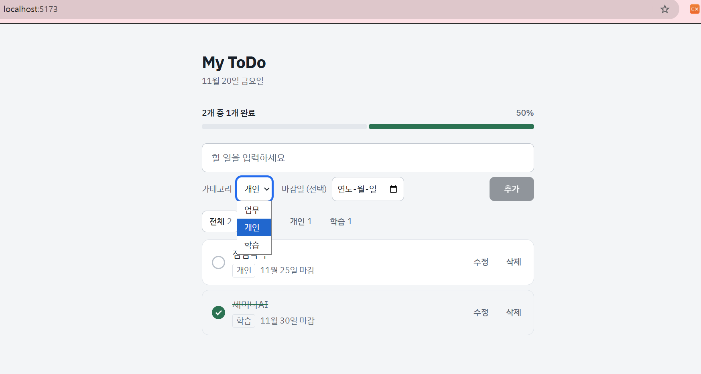
---
<details>
<summary>[SKILL]실습2</summary>

# todo-ui/SKILL.md

```md
---
name: todo-ui
description: ToDo React UI 개발 및 개선에 사용
allowed-tools: Read, Edit, Write, Glob, Grep
---

# UI 개발 규칙

1. React + TypeScript 사용
2. 컴포넌트 재사용
3. 모바일 반응형 지원
4. 로딩 및 오류 상태 표시
5. 접근성 고려

```
[prompt]
```prompt
/todo-ui

현재 Skill에 정의된 allowed-tools 설정을 확인하고,
frontend/src/App.tsx 파일을 Read 도구로 읽어줘.

그다음 Edit 도구로 주석 하나를 추가해줘.

실제로 호출한 도구 이름과 실행 결과를 보고해줘.
```
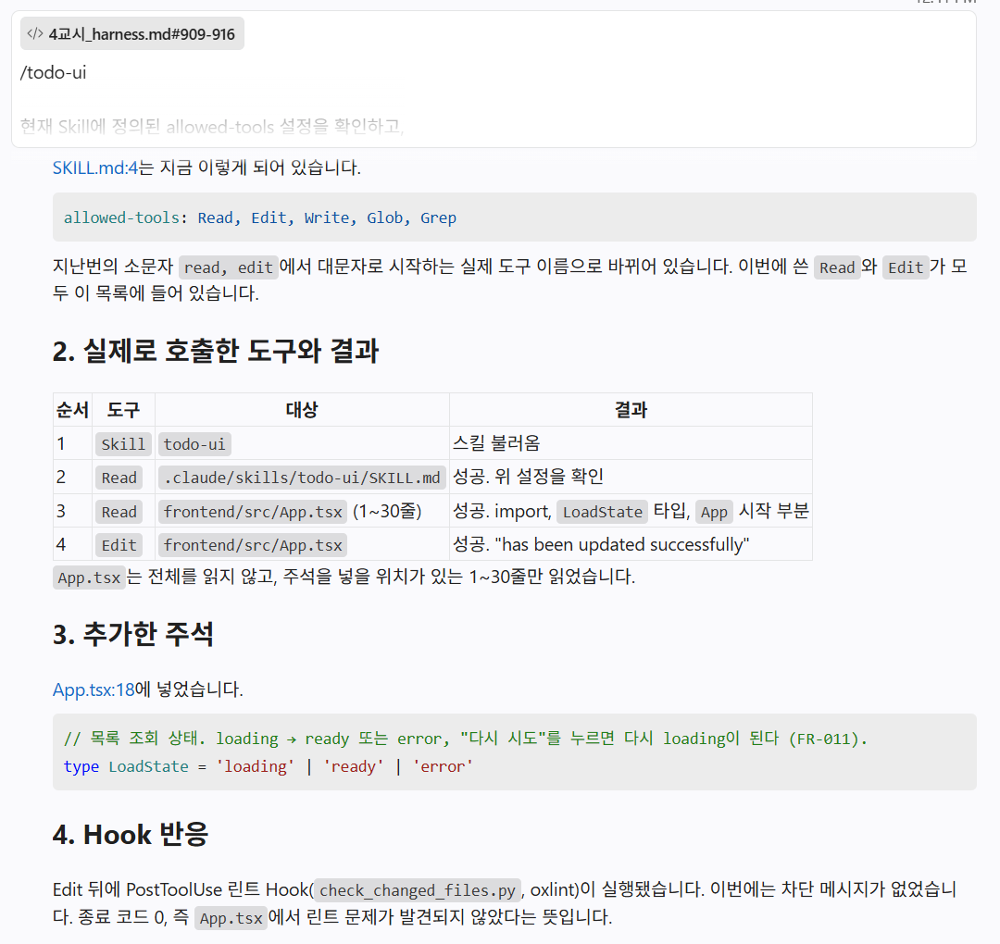

</details>
---
## Step 11. Hook 기반 자동 품질 검증

### 11-1. 학습 목표

Claude Code가 파일을 수정할 때마다(event발생) 자동으로 코드 품질을 검사(로직실행)하도록 Hook을 구성합니다.

```md
> 코드품질의중요성
AI Code Agent 기반 개발에서는 AI가 코드를 생성하는 것뿐만 아니라 기존 코드를 수정하고, 여러 파일을 변경하며, 테스트와 배포까지 자율적으로 수행할 수 있습니다.

그러나 Agent의 자율성이 높아질수록 잘못된 코드가 반복 생성되거나, 기존 기능에 영향을 주고, 오류가 다음 작업으로 확산될 위험도 커집니다. 따라서 **AI Agent의 자율성을 높이기 위해서는 코드 품질을 지속적으로 통제하고 검증**할 수 있는 **하네스 엔지니어링**이 중요합니다.
```

```md
**실습 목표: 입력값 검증 기능과 ESLint/Ruff(정적) 자동 검사**
```
1. 입력값 검증 기능
  - 할 일 제목을 입력하지 않으면 "제목을 입력하세요" 표시
  - 마감일을 잘못 입력하면 오류 메시지 표시
  - 제목이 100자를 초과하면 등록 제한
2. ESLint/Ruff 자동 검사
  - ESLint: React·JavaScript·TypeScript 코드의 잠재적인 오류와 작성 규칙 위반 검사
  - Ruff: Python(FastAPI) 코드의 잠재적인 오류와 작성 규칙 위반 검사
  - 코드 작성 후 자동으로 검사하여 문제점을 개발자에게 알려줌

### 11-2. 핵심 교육내용

```md
Hook은 특정 이벤트가 발생했을 때 미리 정의된 스크립트나 검증 로직을 자동으로 실행하는 기능입니다.

예를 들어, Claude Code에서 다음과 같이 활용할 수 있습니다.
1. 코드 수정 후(PostToolUse): Claude가 파일을 수정하면 ESLint나 Ruff를 자동 실행하여 코드 품질을 검사합니다.
2. 도구 실행 전(PreToolUse): Claude가 위험한 명령어를 실행하려 할 때 이를 검사하고 필요하면 차단합니다.
3. 작업 완료 시(Stop): Claude가 응답을 마치려 할 때 테스트 결과나 완료 조건을 확인합니다.
4. 사용자 요청 시(UserPromptSubmit): 사용자가 프롬프트를 제출하면 사전에 정의한 검증이나 컨텍스트 추가 작업을 수행합니다.

특히 **Hook 자체가 코드의 정확성을 보장하는 것은 아니며**, 검사 스크립트와 테스트가 실제로 무엇을 검증하는지가 중요합니다.
```

| Hook 이벤트 | 실행 시점 | 활용 목적 |
|---|---|---|
| PreToolUse | 도구 실행 직전 | 위험한 작업 차단 또는 승인 |
| PostToolUse | 도구 실행 직후 | 수정된 코드 검사 |
| Stop | Claude 응답 종료 시점 | 검증 상태 점검 |


### 11-3. Hook 실행 구조
Claude Code의 Hook을 활용하여 `코드 수정 전 정책을 검사하고, 수정 후 코드 품질을 자동 검증`하여 오류를 발견하고 수정하는 개발 통제 및 `품질 관리 프로세스`를 구현합니다.

```text
Claude Code: 파일 수정 요청
    │
    ▼
PreToolUse: 실행 전 정책 검사
    │
    ▼
Edit / Write 도구 실행
    │
    ▼
PostToolUse
    │
    ├── React → ESLint / 프로젝트 린터
    │
    └── FastAPI → Ruff
    │
    ▼
검사 결과
    │
    ├── PASS
    │
    └── FAIL → 수정
```

### 11-4. 단계별 실습

**STEP 1. Hook 설정 파일 생성**
```md
`.claude/settings.json`은 **Claude Code의 실행 환경, 도구 권한, Hook 실행 조건 등을 정의하는 프로젝트 설정 파일**입니다.

특히 Hook에서는 **어떤 이벤트가 발생했을 때 어떤 스크립트를 실행할지 연결하는 역할**을 합니다.
```
**settings.json과 Hook의 관계**

| 파일 | 역할 |
|---|---|
| `settings.json` | Hook 실행 시점, 대상 도구, 실행 명령 정의 |
| `check_changed_files.py` | 실제 코드 품질 검사 수행 |

```text
.claude/
├── settings.json
└── hooks/
    └── check_changed_files.py
```
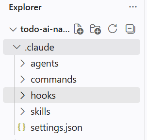

**STEP 2. Claude Code에 Hook 생성 요청**

```text
현재 프로젝트에 .claude/settings.json을 생성해줘.

PostToolUse Hook을 등록하고
Edit 또는 Write 도구가 실행된 후
.claude/hooks/check_changed_files.py를 실행하도록 해줘.

검사 정책:
1. JavaScript/TypeScript: 프로젝트에 설정된 린터 사용
2. Python: Ruff 사용
3. 변경된 파일만 검사
4. 검사 오류를 Claude Code에 보고
5. 기존 settings.json 설정 유지
6. Windows와 macOS/Linux 실행 환경 고려

기존 설정을 분석한 후 변경해줘.
```

**STEP 3. settings.json 구성**
- 먼저 사용자가 Claude Code에 코드 수정을 요청하면, PreToolUse Hook이 실행되어 파일 수정 작업이 허용되는지 미리 확인합니다.

- 검사를 통과하면 Claude Code가 `Edit 또는 Write 도구를 사용`하여 `실제 코드를 수정하거나 새로운 파일을 생성`합니다.

- 파일 수정이 완료되면 `PostToolUse Hook이 실행`되어 `수정된 코드에 문제가 없는지 자동으로 검사`합니다.

```json
{
  "hooks": {
    "PostToolUse": [
      {
        "matcher": "Edit|Write",
        "hooks": [
          {
            "type": "command",
            "command": "python .claude/hooks/check_changed_files.py"
          }
        ]
      }
    ]
  }
}
```

Hook 이벤트는 언제 실행할지를 결정하고, matcher는 어떤 대상에 적용할지를 결정합니다.

**이벤트에 따라 matcher의 의미는 달라짐**

| Hook 이벤트 | matcher 기준 |
|---|---|
| `PreToolUse` | 실행 예정 도구 이름 |
| `PostToolUse` | 실행 완료 도구 이름 |
| `PermissionRequest` | 권한 요청 대상 도구 |
| `SessionStart` | 세션 시작 유형 |
| `SubagentStart` | Subagent 유형 |
| `SubagentStop` | Subagent 유형 |
| `Stop` | matcher 사용하지 않음 |

위 설정은 구조를 설명하기 위한 기본 예시입니다. 실제 스크립트에서는 표준 입력으로 전달되는 Hook JSON의 `tool_input`에서 파일 경로를 읽고, 경로 검증·검사 도구 존재 여부·실패 시 종료 코드까지 처리해야 합니다. Windows에서 `python` 명령을 사용할 수 있는지도 확인합니다.

**STEP 4. 입력값 검증 기능 구현**

```text
기존 ToDo 앱에 입력값 검증을 추가해줘.

1. 빈 제목 등록 차단
2. 공백만 있는 제목 차단
3. 제목 최대 100자 제한
4. FastAPI에서 입력 검증
5. React에서 사용자 오류 메시지 표시
6. 기존 CRUD 및 마감일·카테고리 기능 유지

코드 변경 후 Hook이 정상 실행되는지 확인해줘.
```
[실행결과]
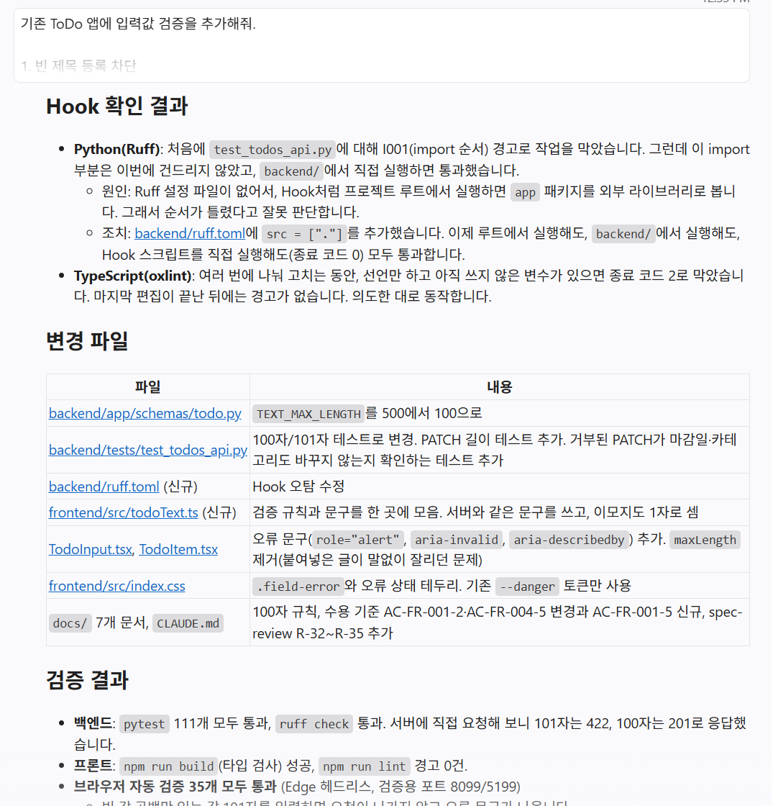

**STEP 5. 의도적인 오류 테스트**

실습용 브랜치에서 문법 또는 린트 오류를 삽입하고 Hook의 탐지 결과를 확인합니다. 이후 오류를 복구하고 다시 검사합니다.

| 테스트 | 기대 결과 |
|---|---|
| 정상 코드 수정 | 검사 통과 |
| Python 린트 오류 | Ruff 오류 보고 |
| JS 린트 오류 | 프론트엔드 린터 오류 보고 |
| 빈 제목 입력 | API 및 UI에서 차단 |
| 100자 초과 | 유효성 검사 오류 |

### 11-5. 산출물 및 완료 기준

- `.claude/settings.json`
- `check_changed_files.py`
- 입력값 검증 기능
- Hook 실행 및 실패 로그

**완료 기준:** 코드 수정 후 Hook이 자동 실행되고, 의도적으로 발생시킨 오류를 탐지해야 합니다.

<details>
<summary>[Hook]실습2</summary>
예를 들어 Claude가 ToDo 앱의 데이터베이스를 초기화하기 위해 DROP TABLE todos를 실행하거나 git push --force를 시도하면 Hook이 이를 감지하고 실행을 차단하도록 구성할 수 있습니다.

```md
현재 ToDo List 프로젝트에 위험 명령어 실행을 방지하는
PreToolUse Hook을 추가해줘.

기존 .claude/settings.json을 분석하고,
기존 Hook 설정을 유지하면서 새로운 Hook을 등록해줘.

Hook 스크립트:
.claude/hooks/check_dangerous_commands.py

실행 조건:
1. Claude Code의 Bash 도구 실행 전
2. PreToolUse 이벤트에서 실행
3. 실행할 명령어를 검사한 후 허용 또는 차단

검사 정책:
1. git push --force, git reset --hard 등
   위험한 Git 명령어 검사
2. rm -rf 등 대량 파일 삭제 명령어 검사
3. DROP TABLE, TRUNCATE 등
   데이터베이스 데이터 삭제 명령어 검사
4. .env 파일 및 민감정보 노출 위험 검사
5. 위험한 명령어가 발견되면 실행 차단
6. 차단 사유를 Claude Code에 전달
7. 정상 명령어는 실행 허용

구현 조건:
1. Python 표준 라이브러리 사용
2. Claude Code Hook 입력 JSON 형식 준수
3. PreToolUse의 차단 응답 형식 준수
4. Windows와 macOS/Linux 호환
5. 기존 settings.json 설정 유지
6. 기존 PostToolUse Hook과 충돌하지 않도록 구성
7. 단순 문자열 검색뿐 아니라 명령어 조합,
   인용부호, 파이프, 명령 치환 등 우회 가능성 검토
8. 검사기가 확실하게 판단할 수 없는 위험 명령은
   자동 허용하지 않고 사용자 확인을 요청하도록 설계

검증 방법:
1. 안전한 명령어 실행 테스트
2. 위험한 Git 명령어 차단 테스트
3. 파일 삭제 명령어 차단 테스트
4. DB 삭제 명령어 차단 테스트
5. 기존 PostToolUse Hook 정상 동작 확인
6. 차단 사유가 Claude Code에 전달되는지 확인

주의사항:
- 실제 위험 명령어를 실행하지 말고
  Hook 스크립트에 모의 입력을 전달하여 테스트해줘.
- 단순 패턴 검사는 모든 우회 명령을 탐지할 수 없으므로
  Claude Code의 도구 권한과 승인 정책도 함께 적용해줘.

기존 설정을 분석한 후 변경하고,
수정 파일과 테스트 결과를 보고해줘.

```
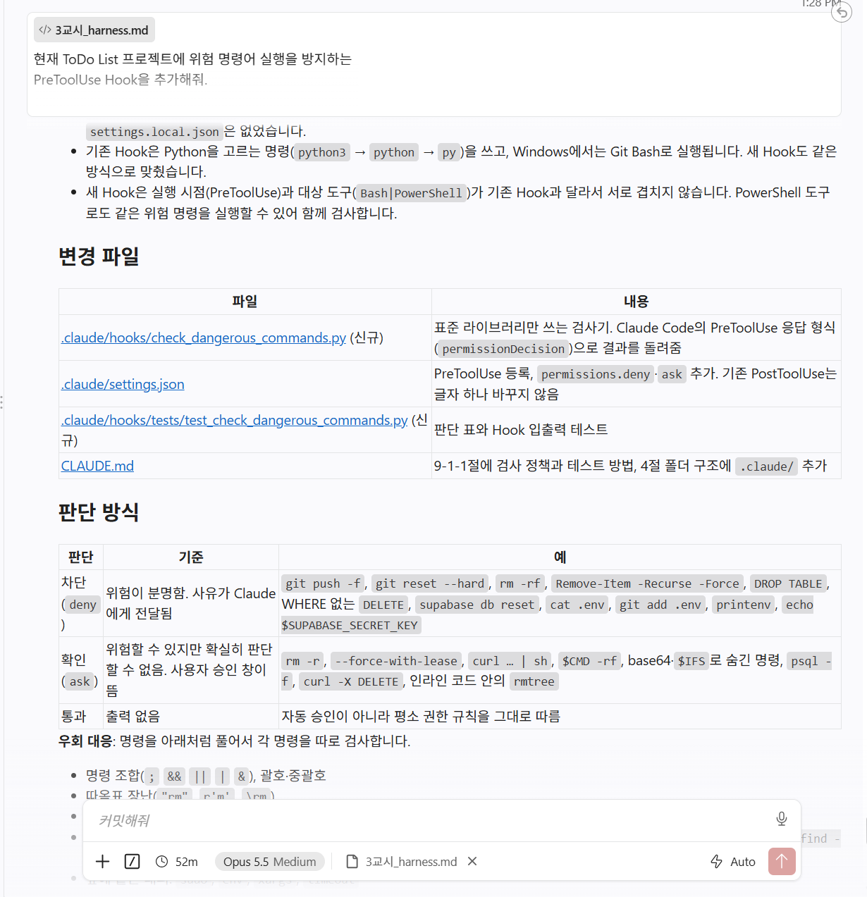

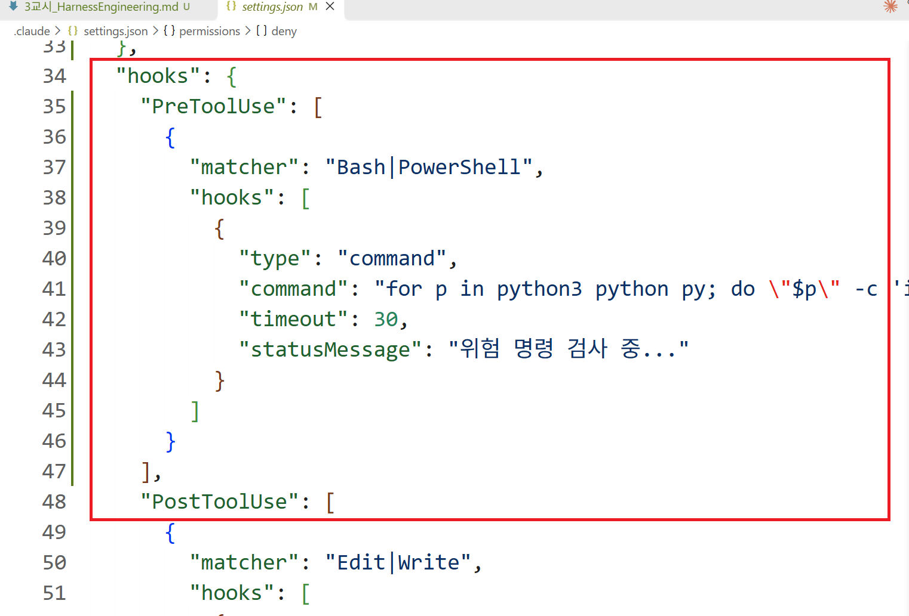


</details>

---

## Step 12. Subagent 기반 역할 분리 개발

### 12-1. 학습 목표

Claude Code의 Subagent를 활용하여 하나의 기능 개발 작업을 분석·구현·검토·테스트 역할로 분리합니다.

**실습 목표: ToDo 우선순위(높음·보통·낮음) 및 정렬 기능 구현**

### 12-2. 핵심 교육내용

| Subagent | 담당 역할 | 주요 산출물 |
|---|---|---|
| Planner | 요구사항 분석, 구현 계획 | 개발 계획 |
| Developer | React·FastAPI 구현 | 기능 코드 |
| Reviewer | 코드 품질 및 명세 준수 검토 | 리뷰 보고서 |
| Tester | API·UI·회귀 테스트 | 테스트 결과 |

### 12-3. Subagent 실행 구조

```text
Claude Code (Main Agent)
    │
    │ 작업 요청 분석 및 위임
    ▼
Planner Agent
    │
    │ PRD 분석 · 계획 수립 · 수용 기준 확인
    ▼
Developer Agent
    │
    │ Frontend · Backend · 데이터 모델 구현
    ▼
┌────────────────────┬────────────────────┐
│ Reviewer Agent     │ Tester Agent       │
│ 품질 검토           │ 테스트 실행         │
└────────────────────┴────────────────────┘
    │
    ▼
Main Agent: 결과 통합 및 최종 보고
```

Reviewer와 Tester는 구현 완료 후 독립적으로 검증할 수 있습니다. 다만 공유 파일을 수정하는 에이전트는 충돌 방지를 위해 순차 실행하거나 Git Worktree로 작업 공간을 분리합니다.

### 12-4. 단계별 실습

**STEP 1. Subagent 디렉터리 생성**

```text
.claude/
└── agents/
    ├── planner.md
    ├── developer.md
    ├── reviewer.md
    └── tester.md
```

**STEP 2. Planner Agent 정의**

파일: `.claude/agents/planner.md`

```markdown
---
name: todo-planner
description: ToDo 기능의 요구사항을 분석하고 구현 계획을 작성하는 전문 에이전트
tools: Read, Grep, Glob
---

# Role
ToDo 프로젝트 요구사항 분석가

# Responsibilities
1. CLAUDE.md 및 PRD 분석
2. 기존 코드 분석
3. 변경 파일 식별
4. 구현 계획 작성
5. 수용 기준 정의

# Constraints
- 소스코드를 수정하지 않는다.
- 확인되지 않은 요구사항을 임의로 결정하지 않는다.
- 기존 API 계약을 유지한다.
```

**STEP 3. 나머지 Subagent 생성**

```text
현재 프로젝트의 .claude/agents/planner.md를 참고하여
다음 Subagent를 생성해줘.

1. todo-developer
   - 승인된 계획을 기준으로 React와 FastAPI 구현
   - 기존 API 계약 유지

2. todo-reviewer
   - 코드 품질, 보안, 명세 준수 검토
   - 기본적으로 읽기 전용

3. todo-tester
   - Pytest 및 Frontend 테스트 실행
   - 수용 기준과 회귀 테스트 검증

각 에이전트의 역할, 사용 도구, 제약사항을
Markdown Frontmatter와 본문으로 정의해줘.
```

**STEP 4. 우선순위 기능 구현**

```text
ToDo 앱에 우선순위 기능을 추가해줘.

요구사항:
1. 높음, 보통, 낮음 우선순위
2. 할 일 등록 및 수정 시 우선순위 선택
3. 우선순위별 정렬
4. 기존 카테고리 및 마감일 기능 유지

작업 방식:
- todo-planner: 계획 작성
- todo-developer: 코드 구현
- todo-reviewer: 품질 검토
- todo-tester: 테스트 수행

각 에이전트의 결과를 구분하여 보고하고,
테스트가 실패하면 원인을 분석한 뒤 수정해줘.
```

**STEP 5. 에이전트별 결과 검증**

| 평가 항목 | 검증 기준 |
|---|---|
| Planner | 구현 계획과 변경 파일 식별 |
| Developer | 요구사항에 따른 코드 구현 |
| Reviewer | 주요 결함 및 개선사항 보고 |
| Tester | 수용 기준별 PASS/FAIL |
| Main Agent | 결과 통합 및 미해결 문제 보고 |

### 12-5. 산출물 및 완료 기준

- 4개 Subagent 정의 파일
- 우선순위 및 정렬 기능
- 에이전트별 실행 결과
- 코드 리뷰 및 테스트 보고서

**완료 기준:** 역할별 작업 결과를 구분할 수 있고, Main Agent가 결과를 통합하여 최종 수용 기준을 검증해야 합니다.

### 12-6. 테스트를 위한 프롬프트

```prompt
ToDo 앱에 우선순위 및 정렬 기능을 추가해줘.
기능이 구현되어 있다면 검증만 진행해줘

요구사항:
1. 높음, 보통, 낮음 우선순위 제공
2. 할 일 등록 및 수정 시 우선순위 선택
3. 우선순위별 정렬 (높음 → 보통 → 낮음)
4. 기존 카테고리 및 마감일 기능 유지
5. 기존 CRUD 기능 유지

Subagent 실행 순서:
1. todo-planner: 요구사항 분석 및 구현 계획
2. todo-developer: 코드 구현
3. todo-reviewer: 코드 품질 및 보안 검토
4. todo-tester: API·UI·회귀 테스트

Reviewer와 Tester는 구현 완료 후 독립적으로 검증해줘.

테스트가 실패하면 Developer가 수정하고 다시 검증해줘.

마지막으로 각 에이전트의 작업 결과와 PASS/FAIL을 구분하여 보고해줘.
```
<details>
<summary>subagent진행과정_캡쳐</summary>

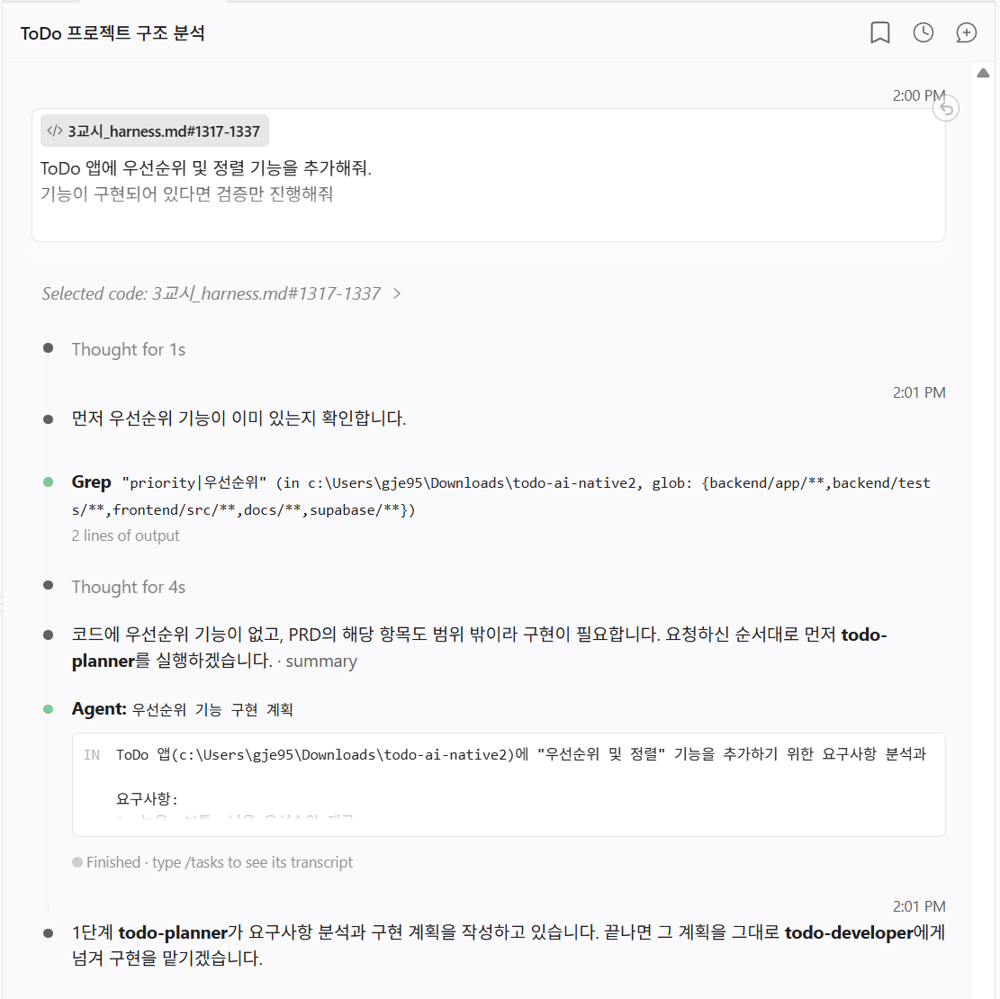


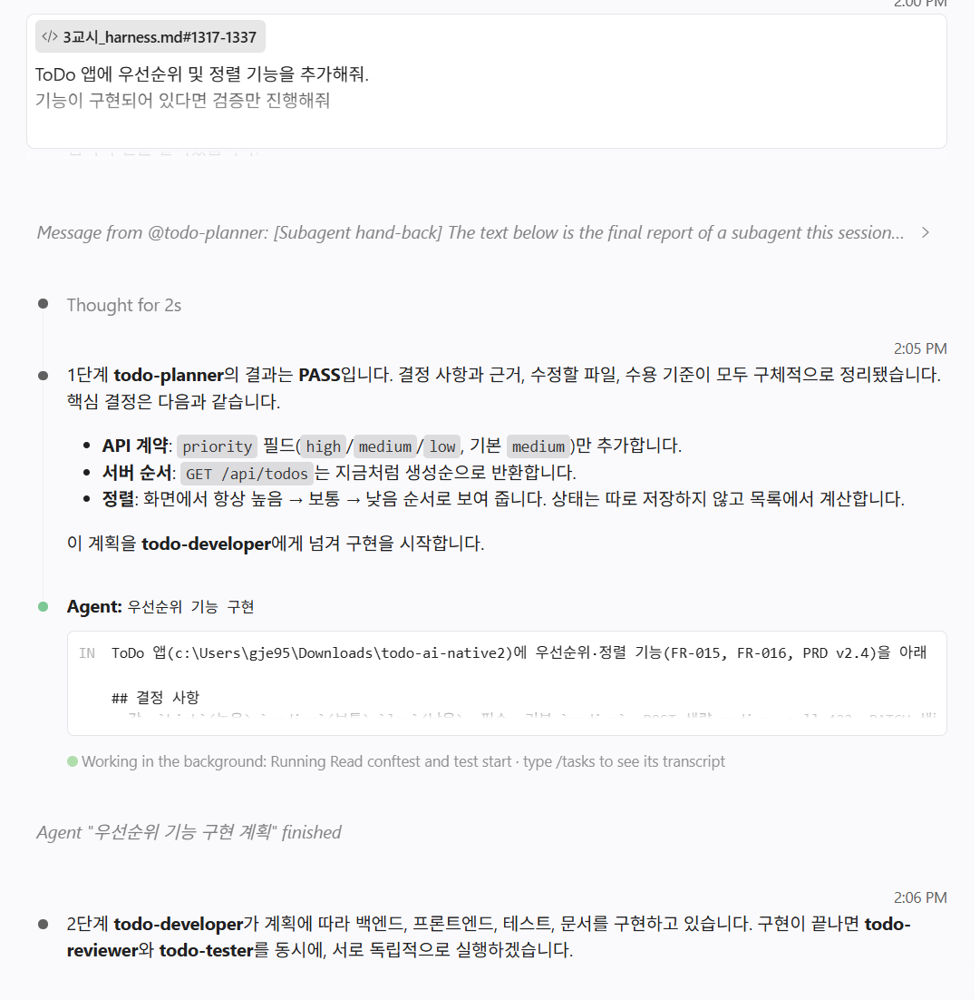


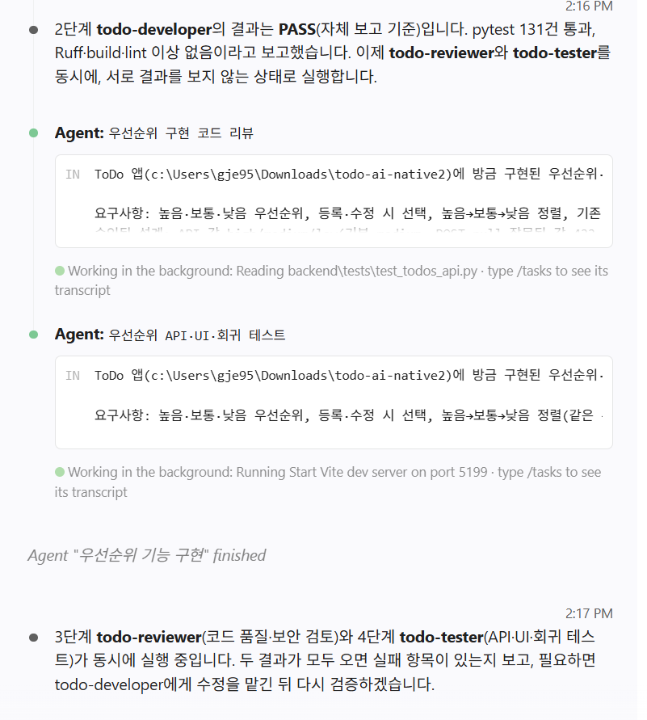

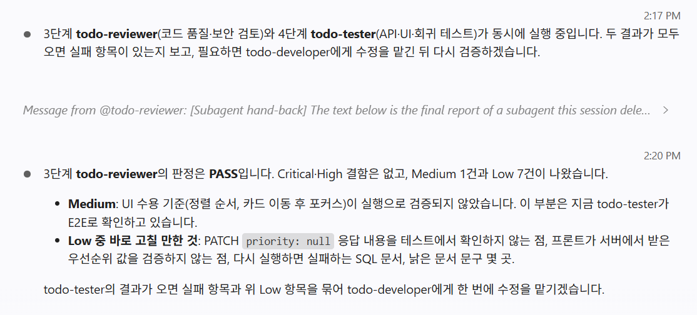
</details>
---

## Step 13. MCP 기반 외부 도구 연동

### 13-1. 학습 목표

Claude Code에 외부/내부 시스템을 연결하여 DB 확인, 브라우저 테스트 등의 작업을 수행합니다.

Step 8에서 Supabase MCP를 적용했다면 기존 연결을 재사용하고, 적용하지 않았다면 Playwright MCP를 중심으로 실습합니다.

### 13-2. MCP란?

**MCP(Model Context Protocol)**는 AI Agent가 외부 시스템의 도구와 데이터에 표준화된 방식으로 접근할 수 있도록 지원하는 프로토콜입니다.

Claude Code는 MCP를 통해 데이터베이스 조회, 웹 브라우저 조작, 외부 API 호출 등의 작업을 수행할 수 있습니다.

| 구분 | 역할 | ToDo 앱 적용 예시 |
|---|---|---|
| Claude Code | AI Agent 실행 환경 | 사용자 요청 분석 및 작업 수행 |
| MCP Client | MCP 서버와 통신 | 외부 도구 목록 조회 및 호출 |
| MCP Server | 외부 도구 기능 제공 | Playwright, Supabase |
| MCP Tool | 실제 작업 수행 기능 | 브라우저 클릭, DB 조회 |

### 13-3. Playwright란?

**Playwright**는 웹 브라우저를 자동으로 실행하여 클릭, 입력, 화면 이동, 기능 테스트 등을 수행하는 브라우저 자동화 도구입니다.

Claude Code에서는 Playwright를 활용하여 AI Agent가 개발한 ToDo List 앱의 기능을 검증할 수 있습니다.

Playwright를 Claude Code에 적용하는 방법은 크게 두 가지입니다.

| 구분 | Playwright Test | Playwright MCP |
|---|---|---|
| 목적 | E2E 테스트 자동화 | AI Agent의 브라우저 직접 조작 |
| 실행 방식 | 테스트 스크립트 실행 | Claude Code가 MCP 도구 호출 |
| 활용 | 반복 테스트, 회귀 테스트, CI/CD | 화면 확인, 클릭, 입력, 오류 탐색 |
| 특징 | 테스트 코드 기반 | 자연어 명령 기반 |

이번 실습에서는 **Playwright MCP를 중심으로 진행**하고, Playwright Test는 선택 실습으로 구성합니다.

### 13-4. Playwright MCP 설치

#### 1. 사전 환경 확인

터미널에서 Node.js와 npm 설치 여부를 확인합니다.

```bash
node -v
npm -v
```

Claude Code 설치 여부도 확인합니다.

```bash
claude --version
```

#### 2. Playwright MCP 등록

Claude Code 세션 밖의 터미널에서 다음 명령을 실행합니다.

```bash
claude mcp add playwright -- npx -y @playwright/mcp@latest
```
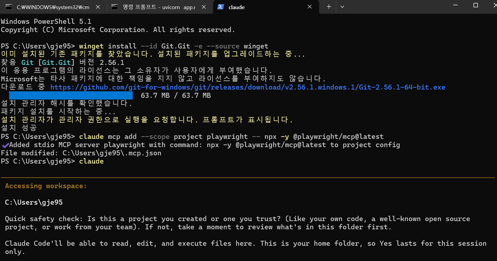

위 명령은 Claude Code에 `playwright`라는 이름으로 MCP 서버를 등록합니다.

프로젝트별로 MCP 설정을 공유하려면 프로젝트 디렉터리에서 다음 명령을 사용할 수 있습니다.

```bash
claude mcp add --scope project playwright -- npx -y @playwright/mcp@latest
```

프로젝트 범위 설정은 `.mcp.json`에 저장되므로, 공유 전에 설정 내용과 보안을 확인합니다.

새로고침한 후 '/mcp'를 다시 입력해본다.
```cli
/exit
```

#### 3. MCP 연결 확인

```bash
claude mcp list
```

Claude Code를 실행합니다.

```bash
claude
```

Claude Code 내부에서 다음 명령으로 MCP 서버 상태를 확인합니다.

```bash
/mcp
```

Playwright MCP가 정상적으로 연결되었는지 확인합니다.

### 13-5. ToDo 앱 실행

Playwright MCP로 테스트하기 전에 ToDo List 앱을 실행합니다.

#### 1. Frontend 실행

프로젝트 루트에서 다음 명령을 실행합니다.

```bash
cd frontend
npm install
npm run dev
```
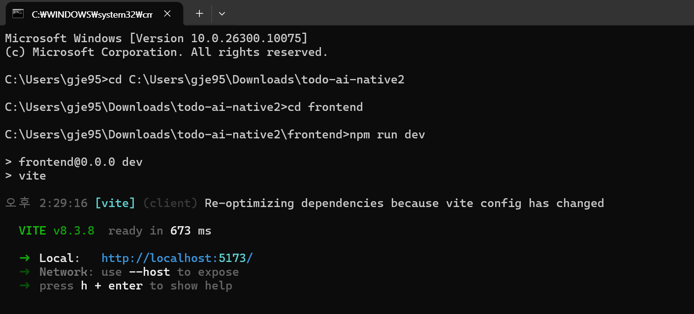
기본 접속 주소:

```text
http://localhost:5173
```

#### 2. Backend 실행

별도의 터미널에서 FastAPI 서버를 실행합니다.

```bash
cd backend
```
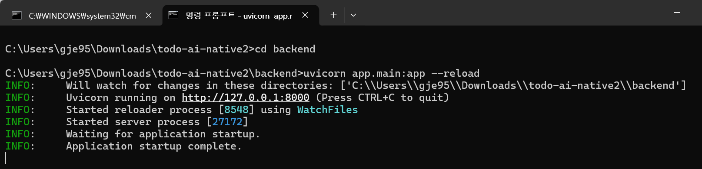

기본 접속 주소:

```text
http://localhost:8000
http://localhost:8000/docs
```

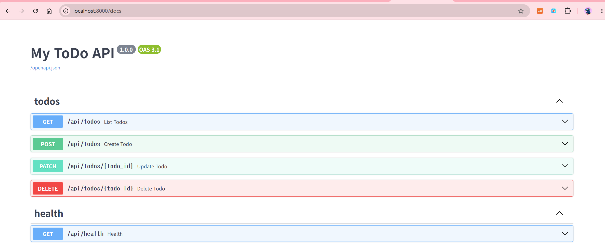

Supabase를 사용하는 경우 환경변수와 DB 연결 상태도 확인합니다.

### 13-6. Playwright MCP 기반 브라우저 테스트

#### 1. 학습 목표

Claude Code가 Playwright MCP를 호출하여 ToDo 앱의 화면과 기능을 직접 검증하도록 합니다.

#### 2. 테스트 시나리오

| 번호 | 테스트 항목 | 검증 내용 | 기대 결과 |
|---|---|---|---|
| 1 | 페이지 접속 | ToDo 앱 접속 | 화면 정상 표시 |
| 2 | ToDo 추가 | 새로운 할 일 입력 및 저장 | 목록에 추가 |
| 3 | ToDo 완료 | 완료 체크박스 클릭 | 완료 상태 반영 |
| 4 | ToDo 삭제 | 삭제 버튼 클릭 | 목록에서 제거 |
| 5 | 데이터 유지 | 페이지 새로고침 | 저장된 데이터 유지 |
| 6 | 반응형 UI | 모바일 화면 크기 변경 | 레이아웃 정상 표시 |

데이터 유지 테스트는 Supabase 등 영속 저장 기능이 구현된 경우 수행합니다.

#### 3. Claude Code 실습 프롬프트

```text
현재 실행 중인 ToDo List 앱을
Playwright MCP로 테스트해줘.

접속 주소:
http://localhost:5173

테스트 시나리오:
1. ToDo 앱 페이지 접속
2. 새로운 ToDo 추가
3. 추가된 ToDo가 목록에 표시되는지 확인
4. 완료 체크박스 클릭
5. 완료 상태가 정상 반영되는지 확인
6. ToDo 삭제
7. 삭제된 항목이 목록에서 제거되는지 확인
8. 페이지 새로고침 후 데이터 유지 여부 확인
9. 모바일 화면에서 UI가 정상 표시되는지 확인

검증 조건:
- 실제 브라우저를 사용해 테스트
- 각 단계의 PASS / FAIL 결과 기록
- 오류 발생 시 재현 절차 작성
- 콘솔 오류 확인
- 테스트 결과를 표로 정리

주의사항:
- 테스트용 데이터만 생성하고 삭제해줘.
- 기존 사용자 데이터는 변경하지 마.
- 오류가 발생하면 우선 원인을 분석하고 보고해줘.
```
▶[실행결과화면]
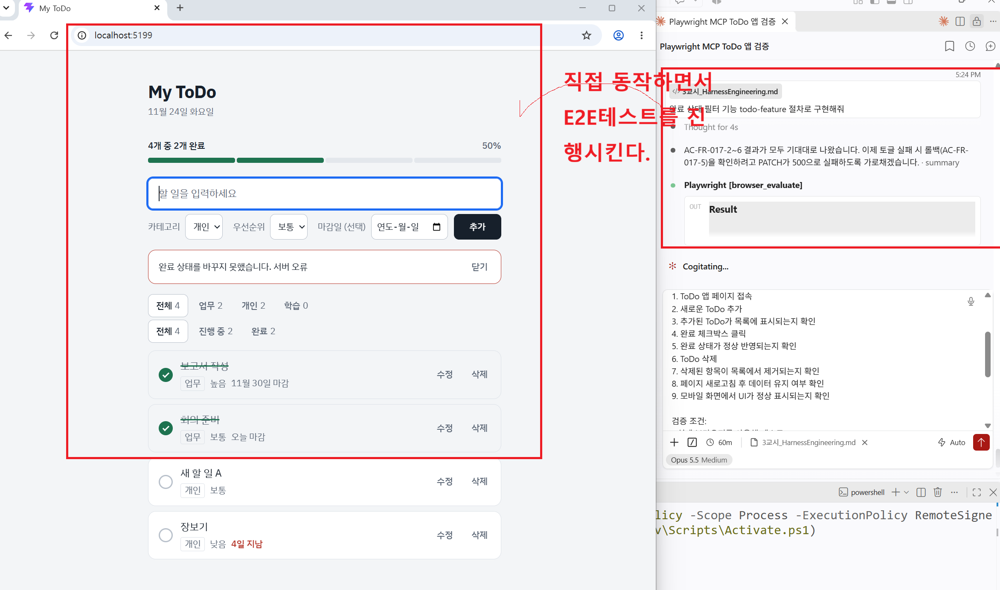

▶[정상구현_실행결과화면]
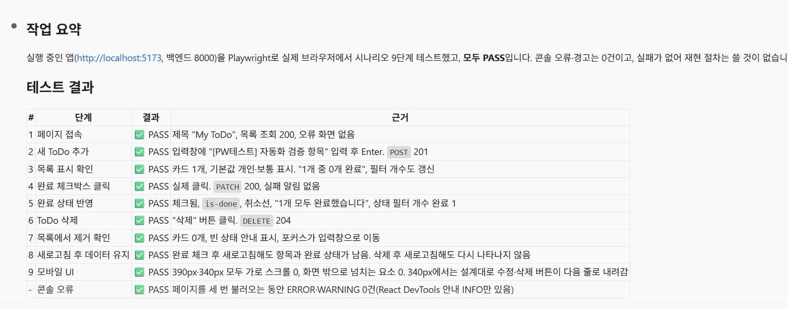


▶[최종_실행결과화면]
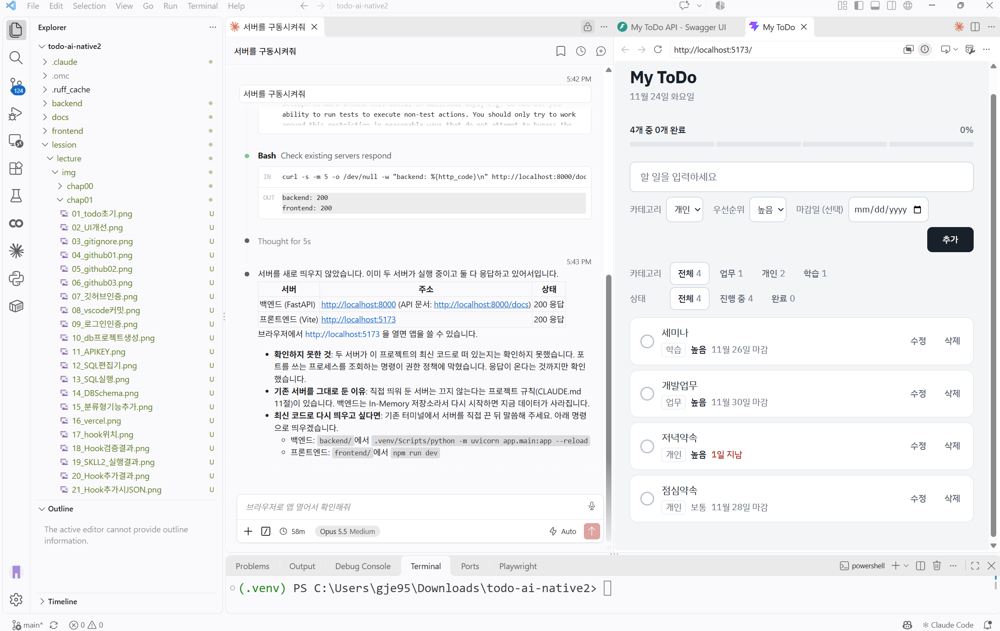

▶[미흡결과_실행결과화면]
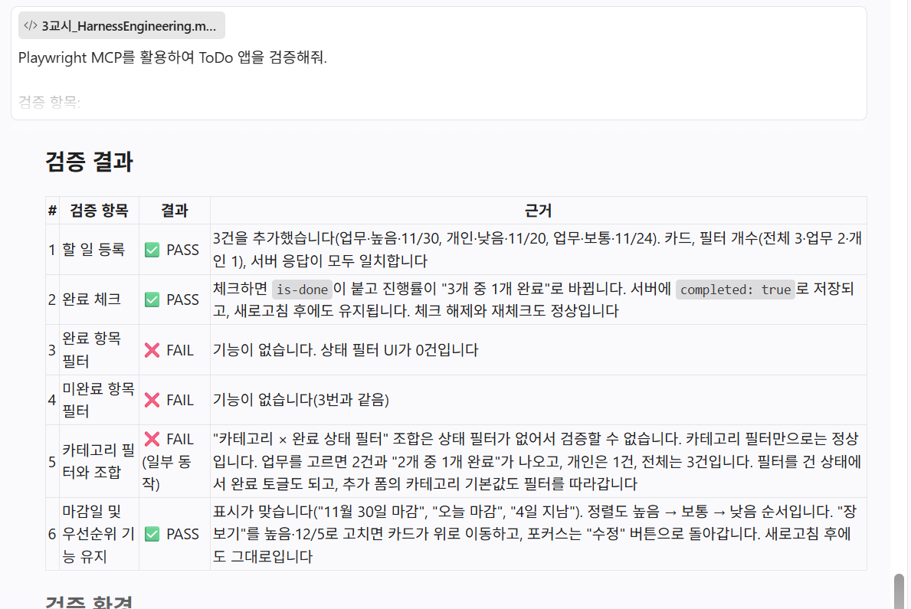


<details>
<summary> 추가내용
<h1>Playwright Test+Supabase DB Test</h1>
</summary>

### 13-7. Playwright Test 설치 및 자동화 [선택]

Playwright MCP가 Claude Code의 브라우저 조작을 지원한다면, Playwright Test는 반복 가능한 E2E 테스트 코드를 작성하고 실행하는 데 사용합니다.

#### 1. Playwright Test 설치

Frontend 디렉터리로 이동합니다.

```bash
cd frontend
```

Playwright를 설치합니다.

```bash
npm init playwright@latest
```

설치 과정에서 다음 항목을 선택합니다.

- TypeScript 사용
- 테스트 디렉터리: `tests`
- GitHub Actions 설정: 필요시 선택
- 브라우저 설치: Yes

#### 2. 브라우저 설치
```md
**Chromium(크로미움)**은 Google이 주도하는 오픈소스 웹 브라우저 프로젝트  
**Playwright**는 Chromium을 실제 웹 브라우저로 실행한 후, 사용자가 브라우저에서 수행하는 작업을 자동화하는 도구입니다.
```
브라우저가 설치되지 않았다면 Chromium을 설치합니다.

```bash
npx playwright install chromium
```

#### 3. 테스트 실행

```bash
npx playwright test
```

HTML 테스트 보고서를 확인합니다.

```bash
npx playwright show-report
```

#### 4. Claude Code 실습 프롬프트

```text
현재 React + FastAPI 기반 ToDo List 프로젝트에
Playwright E2E 테스트를 구성해줘.

요구사항:
1. frontend의 기존 Playwright 설치 여부 확인
2. 설치되지 않았다면 @playwright/test 설치
3. Chromium 브라우저 설치
4. playwright.config.ts 설정
5. ToDo 추가, 완료, 삭제 기능 테스트 작성
6. 기존 테스트 파일 및 설정 유지
7. 실제 테스트 실행 후 결과 보고

검증 조건:
- React 개발 서버 자동 실행
- 필요한 Backend 및 DB 연결 상태 확인
- 테스트 실패 시 오류 원인 분석
- 최대 3회 수정 및 재검증
- PASS / FAIL / SKIP 결과 구분
- 기존 프로젝트 파일 최소 변경

기존 구조를 분석한 후 진행해줘.
```

### 13-8. Supabase MCP 연동 확인 [선택]

Step 8에서 Supabase MCP를 등록했다면 기존 연결을 재사용합니다.

Claude Code에서 다음 명령으로 연결 상태를 확인합니다.

```text
/mcp
```

Supabase MCP가 정상적으로 연결되어 있다면 다음 프롬프트를 실행합니다.

```text
현재 연결된 Supabase MCP를 사용하여
ToDo List 앱의 데이터베이스 구조를 확인해줘.

검증 항목:
1. todos 테이블 존재 여부
2. 테이블 컬럼 및 데이터 타입
3. Primary Key 설정
4. RLS 정책 적용 여부
5. ToDo 추가 및 조회에 필요한 구조 확인

주의사항:
- 데이터 조회 및 스키마 분석만 수행
- 기존 테이블 및 데이터 변경 금지
- DROP, DELETE, TRUNCATE 명령 실행 금지

검증 결과를 표로 정리해줘.
```

</details>

---

### 13-9. MCP 기반 실행 구조

```text
                  사용자
                    │
                    ▼
               Claude Code
                    │
                    ▼
                MCP Client
                    │
          ┌─────────┴─────────┐
          │                   │
          ▼                   ▼
    Playwright MCP        Supabase MCP
          │                   │
          ▼                   ▼
      웹 브라우저          PostgreSQL
          │                   │
          ▼                   ▼
      ToDo UI 검증         DB 구조 확인
          │                   │
          └─────────┬─────────┘
                    │
                    ▼
               Claude Code
                    │
                    ▼
             테스트 결과 분석
                    │
             ┌──────┴──────┐
             │             │
            PASS          FAIL
             │             │
             ▼             ▼
          완료 보고     오류 원인 분석
                           │
                           ▼
                       수정 및 재검증
```

### 13-10. 학습 결과 및 확인 사항

| 평가 항목 | 확인 기준 |
|---|---|
| MCP 이해 | MCP Client와 Server의 역할을 설명할 수 있는가? |
| MCP 설치 | Playwright MCP를 등록하고 연결 상태를 확인했는가? |
| 브라우저 조작 | Claude Code로 실제 브라우저를 실행했는가? |
| 기능 검증 | ToDo 추가·완료·삭제 기능을 검증했는가? |
| 오류 분석 | 테스트 실패 원인과 재현 절차를 설명할 수 있는가? |
| 외부 시스템 연동 | MCP를 통해 브라우저 또는 DB에 접근했는가? |

### 13-11. 핵심 정리

**MCP는 Claude Code가 외부 시스템의 기능을 활용할 수 있도록 연결하는 표준 프로토콜입니다.**

- Playwright MCP: 브라우저 조작 및 UI 기능 검증
- Supabase MCP: 데이터베이스 구조 및 데이터 확인
- Playwright Test: 반복 가능한 E2E 자동 테스트

AI Native Engineering 관점에서 MCP는 **Agent가 활용할 수 있는 외부 도구를 확장**하며, Harness Engineering과 결합하면 도구 권한 통제 및 검증 자동화에 활용할 수 있습니다.

### 13-12. 참고 자료

- Playwright: https://playwright.dev/
- Playwright Test: https://playwright.dev/docs/intro
- Playwright MCP: https://github.com/microsoft/playwright-mcp
- Claude Code MCP: https://code.claude.com/docs/en/mcp
- Supabase MCP: https://supabase.com/docs/guides/getting-started/mcp


---
[Gitbhub 추가]
Claude Code에 외부 시스템을 연결하여 GitHub Issue 조회, DB 확인, 브라우저 테스트 등의 작업을 수행합니다.
```md
**GitHub Issue(이슈)**란 소프트웨어 개발 과정에서 발생하는 버그, 기능 추가 요청, 개선 사항, 작업 할 일 등을 등록하고 관리하는 기능입니다.

쉽게 말해, GitHub 저장소에서 개발해야 할 작업을 기록하고 추적하는 작업 관리 도구입니다.
```
Step 8에서 Supabase MCP를 적용했다면 기존 연결을 재사용하고, 적용하지 않았다면 GitHub와 Playwright MCP를 중심으로 실습합니다.

<details>
<summary>
GitHub Issue 기반 ToDo 필터 기능 개선 및 E2E 검증
</summary>

**실습 목표: GitHub Issue 기반 ToDo 필터 기능 개선 및 E2E 검증**

### 13-2. 핵심 교육내용

| 기술 | 역할 | 실습 내용 |
|---|---|---|
| MCP Host | 외부 도구를 사용하는 AI 앱 | Claude Code |
| MCP Client | MCP 서버와 통신 | Claude Code 내부 연결 |
| MCP Server | 외부 기능 제공 | GitHub, Playwright |
| Tool | 외부 기능 실행 | Issue 조회, 브라우저 조작 |
| Resource | 외부 데이터 제공 | 서버별 제공 리소스 |
| Authorization | 외부 서비스 인증 | OAuth 또는 토큰 |

### 13-3. MCP 기반 개발 흐름

```text
GitHub Issue
    │
    │ 개발 요구사항
    ▼
Claude Code + MCP Client
    │
    ├── GitHub MCP
    │   └── Issue / PR
    │
    ├── Supabase MCP
    │   └── DB 조회
    │
    └── Playwright MCP
        └── 브라우저 검증
    │
    ▼
Skill + Subagent + Hook
    │
    │ 기능 구현 및 자동 검증
    ▼
E2E 검증 → Pull Request
```

### 13-4. 단계별 실습

**STEP 1. MCP 연결 확인**

Claude Code에서 다음 명령을 실행합니다.

```bash
/mcp
```

등록된 MCP 서버와 인증 상태를 확인합니다.

**STEP 2. GitHub MCP 연결**

Claude Code의 MCP 등록 기능을 사용해 GitHub MCP 서버를 연결합니다. 서버 URL, 인증 방식, 사용 가능한 도구는 설치 시점의 공식 설정을 확인합니다.

```text
GitHub MCP 연결 상태를 확인해줘.

현재 저장소의 Issue를 조회할 수 있는지 확인하고
사용 가능한 GitHub 도구 목록을 알려줘.

아직 Issue나 PR을 수정하지 마.
```

**STEP 3. GitHub Issue 준비**

GitHub에서 다음 내용의 Issue를 생성합니다.

```markdown
# ToDo 완료 항목 필터 개선

## 요구사항
- 완료된 ToDo만 조회
- 미완료 ToDo만 조회
- 전체 보기 지원
- 기존 카테고리 필터와 함께 동작

## 수용 기준
1. 완료 필터 선택 시 완료 항목만 표시
2. 미완료 필터 선택 시 미완료 항목만 표시
3. 전체 선택 시 모든 항목 표시
4. 기존 CRUD 기능 유지
```

**STEP 4. Issue 기반 기능 개발**

```text
GitHub MCP를 사용하여 현재 저장소의
완료 항목 필터 개선 Issue를 조회해줘.

이후 다음 절차를 수행해줘.

1. Issue 요구사항 분석
2. todo-feature Skill 적용
3. Planner Agent로 구현 계획 작성
4. Developer Agent로 기능 구현
5. Hook으로 정적 검사
6. Reviewer Agent로 코드 리뷰
7. Tester Agent로 API 테스트
8. Playwright MCP로 브라우저 검증
9. Pull Request 초안 작성

외부 시스템 변경과 실제 PR 생성은
내 승인을 받은 후 진행해줘.
```

**STEP 5. Playwright MCP 검증(필수)**

```text
Playwright MCP를 활용하여 ToDo 앱을 검증해줘.

검증 항목:
1. 할 일 등록
2. 완료 체크
3. 완료 항목 필터
4. 미완료 항목 필터
5. 카테고리 필터와 조합
6. 마감일 및 우선순위 기능 유지

테스트 결과를 PASS/FAIL 표로 작성해줘.
```

### 13-5. 산출물 및 완료 기준

- MCP 연결 설정
- GitHub Issue 기반 기능 개선
- Playwright E2E 테스트 결과
- Pull Request 초안

**완료 기준:** GitHub Issue의 요구사항을 기반으로 기능을 구현하고 브라우저 테스트까지 수행해야 합니다.
</details>
---

## Step 14. Custom Plugin 및 Harness 통합 프로젝트

### 14-1. 학습 목표

Step 9~13에서 만든 Command, Skill, Hook, Subagent 및 MCP 설정을 하나의 Claude Code Plugin으로 패키징합니다.

**실습 목표: 다른 프로젝트에서도 재사용 가능한 `todo-dev-plugin` 제작**

### 14-2. 핵심 교육내용

| 구성요소 | Plugin 내부 역할 |
|---|---|
| Command | 개발 명령 실행 |
| Skill | 개발 지식 및 절차 |
| Hook | 자동 검사 |
| Subagent | 전문 역할 수행 |
| MCP | 외부 시스템 연결 |
| Manifest | 플러그인 메타정보 |

### 14-3. Plugin 디렉터리 구조

```text
todo-dev-plugin/
├── .claude-plugin/
│   └── plugin.json
├── commands/
│   └── todo-feature.md
├── skills/
│   ├── todo-feature/
│   │   └── SKILL.md
│   └── todo-frontend/
│       └── SKILL.md
├── agents/
│   ├── planner.md
│   ├── developer.md
│   ├── reviewer.md
│   └── tester.md
├── hooks/
│   └── hooks.json
├── scripts/
│   └── check_changed_files.py
├── .mcp.json
└── README.md
```

### 14-4. 단계별 실습

**STEP 1. Plugin Manifest 작성**

파일: `.claude-plugin/plugin.json`

```json
{
  "name": "todo-dev",
  "version": "1.0.0",
  "description": "Claude Code 기반 ToDo 개발 자동화 플러그인",
  "author": {
    "name": "ToDo AI Native Team"
  }
}
```

**STEP 2. 기존 Harness 구성요소 통합**

```text
현재 프로젝트의 Harness 구성요소를 분석해줘.

대상:
1. .claude/commands/
2. .claude/skills/
3. .claude/agents/
4. .claude/settings.json의 Hook
5. MCP 연결 설정

이 구성요소를 todo-dev-plugin으로 패키징해줘.

기존 프로젝트의 절대 경로와 비밀 정보가
플러그인에 포함되지 않도록 확인해줘.

각 구성요소의 경로를 Plugin 규격에 맞게 변경하고
설치 및 실행 방법을 README.md에 작성해줘.
```

**STEP 3. Frontend Skill 통합**

Step 3의 UI 디자인 규칙을 재사용하는 `todo-frontend` Skill을 추가합니다.

포함 내용은 UI 요구사항 분석, UI Guidelines 확인, React 컴포넌트 설계, 반응형 구현, 접근성 검증, Playwright 테스트입니다.

외부에서 설치한 Frontend Design Plugin 자체를 복제하지 않고 직접 작성한 규칙과 도구만 패키징합니다.

**STEP 4. Plugin 로컬 테스트**

프로젝트 루트에서 다음과 같이 개발 중인 플러그인을 로드할 수 있습니다.

```bash
claude --plugin-dir ./todo-dev-plugin
```

Claude Code에서 플러그인의 명령과 Skill이 인식되는지 확인합니다.

플러그인에 포함된 MCP 설정은 별도 인증이 필요할 수 있으므로 연결 상태를 다시 확인합니다.

**STEP 5. 최종 통합 실습**

```text
todo-dev Plugin을 사용하여
기존 ToDo 앱에 키워드 검색 기능을 추가해줘.

요구사항:
1. 제목 기반 검색
2. 카테고리 및 완료 필터와 조합
3. 검색어 초기화
4. 기존 CRUD 기능 유지

작업 절차:
1. Command로 개발 요청
2. Skill로 개발 절차 적용
3. Planner/Developer 역할 분리
4. Hook으로 자동 검사
5. Reviewer/Tester 검증
6. Playwright MCP로 E2E 테스트
7. 최종 결과 보고

각 Harness 구성요소의 실행 여부를
표로 정리해줘.
```

### 14-5. 산출물 및 완료 기준

- `todo-dev-plugin/`
- Plugin Manifest
- Command, Skill, Hook, Subagent
- MCP 설정
- 설치 및 사용 가이드
- 최종 통합 테스트 결과

**완료 기준:** 별도의 테스트 프로젝트에서 Plugin을 로드하고 주요 Harness 구성요소를 재사용할 수 있어야 합니다.

---

## 3. 최종 Harness Engineering 아키텍처

```text
개발자
  │
  │ 기능 요구사항 · 승인 · 최종 검토
  ▼
┌────────────────────────────────────────┐
│         Claude Code Harness            │
│                                        │
│  ┌──────────────┬──────────────────┐    │
│  │ Command      │ Skill            │    │
│  │ 기능 개발 실행 │ 절차·지식 활용    │    │
│  ├──────────────┼──────────────────┤    │
│  │ Subagent     │ Hook             │    │
│  │ 분석·구현·검토 │ 코드 자동 검증    │    │
│  └──────────────┴──────────────────┘    │
│                                        │
│  MCP Tool Layer                        │
│  GitHub · Supabase · Playwright        │
└────────────────────────────────────────┘
  │
  ▼
┌────────────────────────────────────────┐
│         ToDo List Application          │
│                                        │
│  React Frontend                        │
│       │                                │
│       ▼                                │
│  FastAPI Backend                       │
│       │                                │
│       ▼                                │
│  Repository (DB / Memory)              │
└────────────────────────────────────────┘
  │
  ▼
검증 → Pull Request → 승인 후 배포
(Pytest · 정적 검사 · E2E · Vercel 선택)
```

## 4. 최종 평가 기준

| 평가 항목 | 배점 |
|---|---|
| Command 기반 기능 개발 | 15 |
| Skill 구성 및 재사용 | 15 |
| Hook 자동 검증 | 20 |
| Subagent 역할 분리 및 협업 | 20 |
| MCP 외부 도구 활용 | 15 |
| Plugin 패키징 및 통합 검증 | 15 |
| **합계** | **100** |

## 5. 교육과정의 핵심 학습 성과

이번 Part 5는 다음과 같이 개발 방식이 발전하도록 구성한 과정입니다.

| 단계 | 개발 방식의 변화 |
|---|---|
| Step 9 | 반복 프롬프트 → 재사용 명령 |
| Step 10 | 단순 명령 → 전문 지식과 절차 |
| Step 11 | 수동 검증 → 이벤트 기반 자동 검사 |
| Step 12 | 단일 AI 개발 → 전문 에이전트 역할 분리 |
| Step 13 | 로컬 코드 작업 → 외부 시스템 연계 |
| Step 14 | 개별 개발 도구 → 재사용 가능한 개발 하네스 |

이 과정에서 중요한 것은 **Command, Skill, Hook, Subagent, MCP를 단순히 설치하거나 사용하는 것이 아니라, 각각이 필요한 이유를 ToDo 프로젝트의 실제 개발 문제를 통해 이해하는 것**입니다.

또한 Step 9~14를 진행하면서 Step 6에서 작성한 PRD·API 명세·수용 기준을 지속적으로 갱신해야 합니다. 이것이 앞서 학습한 SDD와 Harness Engineering을 연결하는 핵심입니다.

최종적으로 학습자는 **요구사항 정의 → 계획 → 구현 → 자동 검증 → 에이전트 협업 → 외부 도구 활용 → 결과 승인**으로 이어지는 AI Native 개발 체계를 직접 구성하게 됩니다.


# 참고

## 전문 AI Agent Skill 및 개발 도구 모음

| 번호 | 프로젝트 | 주요 특징 | 활용 목적 | GitHub 링크 주소 |
|---|---|---|---|---|
| 1 | GitHub Spec Kit | 명세 중심 개발(SDD)을 위한 체계적인 개발 절차 제공 | 요구사항 분석, 설계, 작업 분해, 구현 및 검증 | https://github.com/github/spec-kit |
| 2 | Vercel React Best Practices | React·Next.js 성능 최적화 및 코드 작성 모범 사례 제공 | 프론트엔드 성능 개선, 렌더링 및 번들 최적화 | https://github.com/vercel-labs/agent-skills/blob/main/skills/react-best-practices/SKILL.md |
| 3 | GitHub Awesome Copilot | 다양한 개발 분야의 Agent Skill 및 재사용 가능한 개발 지침 제공 | 목적별 Skill 탐색, 설치 및 활용 | https://github.com/github/awesome-copilot/tree/main/skills |
| 4 | Addy Osmani Agent Skills | 실무 중심의 개발·테스트·보안·리뷰·배포 워크플로우 제공 | 전문 개발 절차 자동화 및 코드 품질 향상 | https://github.com/addyosmani/agent-skills |

### Claude Code 실습 적용 권장

| 개발 단계 | 추천 프로젝트 | 적용 내용 |
|---|---|---|
| 요구사항 및 설계 | GitHub Spec Kit | PRD, SPEC, TASKS 기반 명세 중심 개발 |
| 프론트엔드 구현 | Vercel React Best Practices | React 코드 품질 및 성능 최적화 |
| 전문 Skill 확장 | GitHub Awesome Copilot | 목적별 Skill 탐색 및 재사용 |
| 코드 검토 및 품질 관리 | Addy Osmani Agent Skills | 개발·테스트·리뷰·배포 절차 개선 |

> **참고:** GitHub Spec Kit은 단일 Skill이 아닌 명세 중심 개발 도구이며, 나머지는 AI 코딩 에이전트에서 활용할 수 있는 전문 Skill 또는 Skill 모음입니다.
