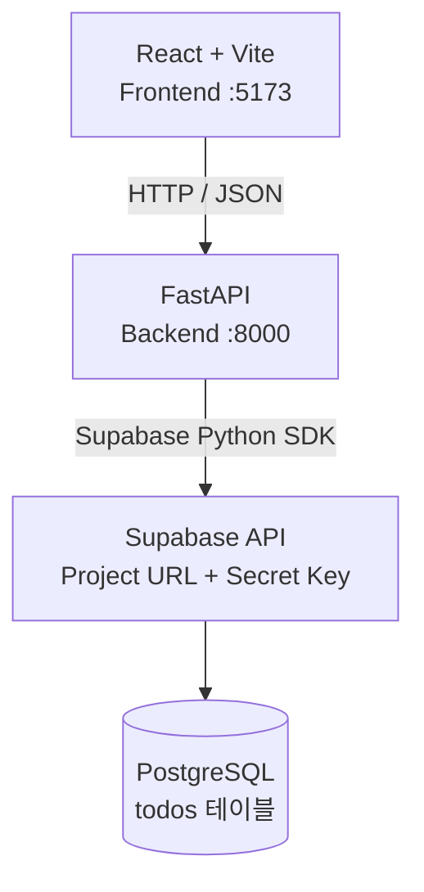
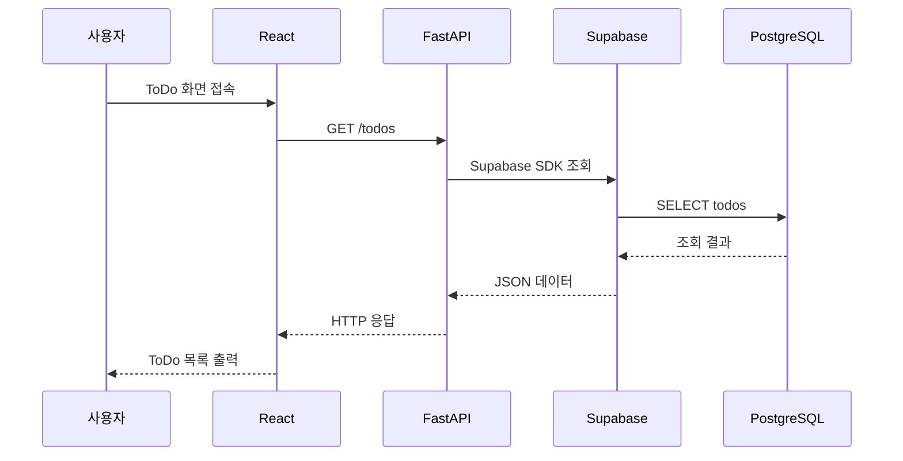
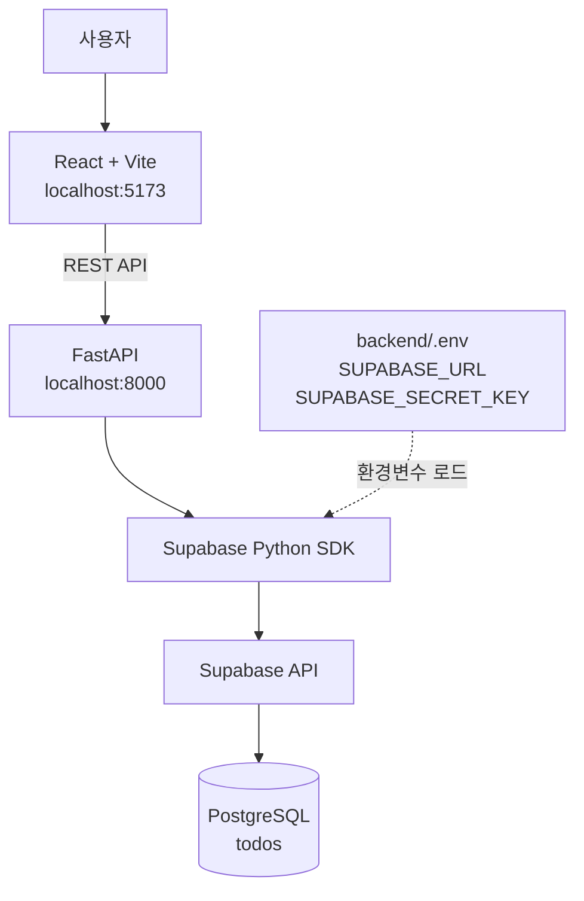

# Supabase 설치 및 연동 실습 가이드

**Claude Code + React(Vite) + FastAPI + Supabase 기반 ToDo List 프로젝트**

Supabase는 PostgreSQL 데이터베이스를 클라우드에서 제공하고, 인증·스토리지·API 등의 기능을 함께 제공하는 백엔드 플랫폼입니다.

이번 실습에서는 다음 순서로 진행합니다.

**Supabase 프로젝트 생성 → API Key 발급 → 환경변수 설정 → DB 테이블 생성 → FastAPI 연결 → React 연동 → 정상 작동 확인**

---

# 1. 전체 아키텍처



## 1-1. 각 기술의 역할

| 구성요소 | 기술 | 역할 |
|---|---|---|
| Frontend | React + Vite | 사용자 화면 구성 |
| Backend | FastAPI | REST API 및 비즈니스 로직 |
| Database API | Supabase API | 데이터베이스 접근 |
| Database | PostgreSQL | ToDo 데이터 저장 |
| 개발 도구 | Claude Code | 코드 생성 및 개발 자동화 |

### 핵심 개념

- React는 사용자 인터페이스를 담당합니다.
- FastAPI는 React의 요청을 받아 비즈니스 로직을 처리합니다.
- FastAPI는 Supabase Python SDK를 통해 데이터베이스에 접근합니다.
- Supabase는 PostgreSQL을 관리하고 API를 제공합니다.
- Supabase의 Secret Key는 React에 넣지 않고 FastAPI 서버에서만 사용합니다.

---

# 2. Supabase 프로젝트 생성

## Step 1. 회원가입 및 로그인

1. Supabase 공식 사이트 접속

   https://supabase.com

2. **Start your project** 선택
3. GitHub 계정 또는 이메일로 로그인
4. Organization 생성 또는 기존 Organization 선택

## Step 2. 신규 프로젝트 생성

Supabase Dashboard에서 **New project**를 클릭합니다.

| 설정 항목 | 실습 예시 |
|---|---|
| Organization | 개인 Organization |
| Project name | `todo-ai-native` |
| Database password | 강력한 비밀번호 설정 |
| Region | Northeast Asia (Seoul), 선택 가능 시 |
| Plan | Free (실습용) |

설정 완료 후 **Create new project**를 클릭합니다.

데이터베이스 준비가 완료될 때까지 기다립니다.

### 주의사항

Database password는 PostgreSQL 직접 접속용 비밀번호입니다.

이후 발급받는 API Key와는 다른 값입니다.

---

# 3. Supabase API Key 발급받기

> **가장 중요한 단계**

Supabase는 기존 `anon`, `service_role` 키 대신 새로운 **Publishable Key와 Secret Key** 사용을 권장합니다.

기존 키는 레거시 방식으로 제공됩니다.

## Step 3-1. API Keys 메뉴 이동

1. Supabase Dashboard 접속
2. 생성한 `todo-ai-native` 프로젝트 선택
3. 왼쪽 메뉴에서 **Project Settings** 선택
4. **API Keys** 선택
5. **Publishable and secret API keys** 탭 확인

Supabase Dashboard:

https://supabase.com/dashboard

## Step 3-2. API Key 종류 이해하기

| 구분 | Key 형식 | 사용 위치 | 공개 여부 |
|---|---|---|---|
| Publishable Key | `sb_publishable_...` | React 등 클라이언트 | 공개 가능 |
| Secret Key | `sb_secret_...` | FastAPI 백엔드 | 절대 공개 금지 |
| Legacy anon | `eyJ...` | 구형 프론트엔드 | 공개 가능 |
| Legacy service_role | `eyJ...` | 구형 백엔드 | 절대 공개 금지 |

### Publishable Key

- 브라우저 등 클라이언트 환경에서 사용할 수 있습니다.
- 공개 가능한 키입니다.
- 데이터 접근 권한은 사용자 인증과 RLS 정책에 따라 제한됩니다.

### Secret Key

- 서버 환경에서만 사용합니다.
- 높은 권한을 가진 비밀 키입니다.
- RLS를 우회할 수 있습니다.
- GitHub나 프론트엔드에 노출하면 안 됩니다.

### 이번 프로젝트의 선택

이번 ToDo List 실습에서는 **FastAPI에서 Supabase Secret Key를 사용**합니다.

```text
React
  |
  | HTTP 요청
  v
FastAPI
  |
  | SUPABASE_URL
  | SUPABASE_SECRET_KEY
  v
Supabase
  |
  v
PostgreSQL
```

실제 서비스에서는 FastAPI에서 사용자 인증과 권한 검증을 반드시 구현해야 합니다.

## Step 3-3. Secret Key 발급 및 복사

1. **API Keys** 메뉴 이동
2. **Publishable and secret API keys** 탭 선택
3. Secret Keys 영역 확인
4. 기존 키가 있다면 해당 키 확인
5. 없다면 **Create new secret key** 선택
6. 키 이름 입력

```text
todo-fastapi-backend
```

7. Secret Key 생성
8. `sb_secret_...` 값 복사
9. 복사한 키를 안전하게 보관

새로운 키 방식이 활성화되지 않은 프로젝트에서는 **Create new API keys**를 먼저 선택해야 할 수 있습니다.

## Step 3-4. Project URL 복사

프로젝트 상단의 **Connect** 메뉴에서 Project URL을 확인합니다.

예시:

```env
SUPABASE_URL=https://abcdefghijklmnop.supabase.co
```

`abcdefghijklmnop`는 프로젝트마다 다른 고유 식별자입니다.

### 발급 정보 확인

- [ ] Project URL 복사 완료
- [ ] Secret Key 복사 완료

두 가지 정보가 준비되면 FastAPI 환경변수 설정을 진행합니다.

---

# 4. FastAPI 프로젝트에 Key 적용하기

## Step 4-1. 프로젝트 디렉터리 구조

```text
todo-ai-native/
├── frontend/
│   └── src/
│
├── backend/
│   ├── .env
│   ├── .env.example
│   ├── app/
│   │   ├── main.py
│   │   └── db/
│   │       └── supabase_client.py
│   └── pyproject.toml
│
├── supabase/
│   └── schema.sql
│
└── .gitignore
```

### 주요 파일 역할

| 파일 | 역할 |
|---|---|
| `backend/.env` | Supabase 접속 정보 저장 |
| `backend/.env.example` | 환경변수 설정 예시 |
| `supabase_client.py` | Supabase 클라이언트 생성 |
| `main.py` | FastAPI 서버 및 API |
| `schema.sql` | 데이터베이스 테이블 생성 |
| `.gitignore` | Git 추적 제외 파일 설정 |

## Step 4-2. backend/.env 파일 생성

VS Code에서 `backend` 폴더에 `.env` 파일을 생성합니다.

```dotenv
# Supabase 프로젝트 주소
SUPABASE_URL=https://abcdefghijklmnop.supabase.co

# Supabase Secret Key (서버 전용)
SUPABASE_SECRET_KEY=sb_secret_여기에_발급받은_키
```


### 환경변수 설명

| 변수 | 의미 |
|---|---|
| SUPABASE_URL | Supabase 프로젝트 API 주소 |
| SUPABASE_SECRET_KEY | 서버에서 사용하는 비밀 인증 키 |

### 주의사항

기존 프로젝트에서 다음 변수명을 사용하고 있을 수 있습니다.

```env
SUPABASE_SERVICE_ROLE_KEY=...
```

이 변수는 기존 Legacy service_role 키에 사용하던 이름입니다.

새로운 Secret Key를 사용하면서 변수명을 `SUPABASE_SECRET_KEY`로 변경한다면 Python 코드도 함께 수정해야 합니다.

## Step 4-3. .env.example 작성

실제 Secret Key를 포함하지 않는 환경변수 예시 파일을 생성합니다.

파일: `backend/.env.example`

```dotenv
SUPABASE_URL=https://YOUR_PROJECT_ID.supabase.co
SUPABASE_SECRET_KEY=YOUR_SECRET_KEY
```

이 파일은 GitHub에 업로드해도 됩니다.

## Step 4-4. GitHub 업로드 방지

프로젝트 루트의 `.gitignore`에 다음 내용을 추가합니다.

```gitignore
# Environment variables
.env
.env.*
!.env.example

# Python
__pycache__/
.venv/

# Node
node_modules/
dist/
```

`.env` 파일이 이미 Git에 추적되고 있었다면 다음 명령으로 추적을 해제합니다.

```bash
git rm --cached backend/.env
```

### 주의사항

이미 GitHub에 Secret Key가 노출된 적이 있다면 Git 추적 해제만으로는 부족합니다.

Supabase에서 해당 키를 교체해야 합니다.

```prompt
supbase의 API key와 url 정보는 .env에 있고 db명은 [본인DB]이고 암호는 [본인DB암호] 이야 이에 맞게 md파일을 변경해줘
```

---

# 5. Supabase Python SDK 설치

FastAPI 서버에서 Supabase에 접속하려면 Python SDK가 필요합니다.

## Step 5-1. backend 디렉터리 이동

```bash
cd backend
```

## Step 5-2. 라이브러리 설치

### uv 기반 프로젝트

```bash
uv add supabase python-dotenv fastapi uvicorn
```

### pip 기반 프로젝트

```bash
pip install supabase python-dotenv fastapi uvicorn
```

### 라이브러리 역할

| 라이브러리 | 역할 |
|---|---|
| supabase | Supabase API 연동 |
| python-dotenv | .env 환경변수 로드 |
| fastapi | REST API 서버 구현 |
| uvicorn | FastAPI 실행 서버 |

## Step 5-3. Supabase 연결 코드 작성

파일: `backend/app/db/supabase_client.py`

```python
import os
from pathlib import Path
from dotenv import load_dotenv
from supabase import create_client, Client

# backend/.env 로드
env_path = Path(__file__).resolve().parents[2] / ".env"
load_dotenv(env_path)

SUPABASE_URL = os.getenv("SUPABASE_URL")
SUPABASE_SECRET_KEY = os.getenv("SUPABASE_SECRET_KEY")

if not SUPABASE_URL or not SUPABASE_SECRET_KEY:
    raise RuntimeError(
        "Supabase 환경변수가 설정되지 않았습니다."
    )

supabase: Client = create_client(
    SUPABASE_URL,
    SUPABASE_SECRET_KEY
)
```

### 코드 설명

1. `load_dotenv()`으로 환경변수를 불러옵니다.
2. `os.getenv()`으로 URL과 Secret Key를 읽습니다.
3. 환경변수가 없다면 오류를 발생시킵니다.
4. `create_client()`로 Supabase 클라이언트를 생성합니다.

이 단계에서는 클라이언트 객체를 생성합니다.

실제 데이터베이스 연결 성공 여부는 데이터 조회 테스트로 확인합니다.

---

# 6. Supabase 데이터베이스 테이블 생성

## Step 6-1. SQL Editor 실행

1. Supabase Dashboard 접속
2. 왼쪽 메뉴 **SQL Editor** 선택
3. **New query** 클릭
4. SQL 코드 입력
5. **Run** 클릭

## Step 6-2. todos 테이블 생성

파일: `supabase/schema.sql`

```sql
CREATE TABLE IF NOT EXISTS public.todos (
    id UUID PRIMARY KEY DEFAULT gen_random_uuid(),
    title TEXT NOT NULL,
    completed BOOLEAN NOT NULL DEFAULT FALSE,
    created_at TIMESTAMPTZ NOT NULL DEFAULT NOW()
);

-- Row Level Security 활성화
ALTER TABLE public.todos
ENABLE ROW LEVEL SECURITY;

-- 클라이언트 역할의 직접 접근 권한 제거
REVOKE ALL ON TABLE public.todos
FROM anon, authenticated;

-- 서버의 service_role 접근 허용
GRANT ALL ON TABLE public.todos
TO service_role;
```

### 테이블 구조

| 컬럼 | 자료형 | 설명 |
|---|---|---|
| id | UUID | 고유 식별자 |
| title | TEXT | 할 일 내용 |
| completed | BOOLEAN | 완료 여부 |
| created_at | TIMESTAMPTZ | 생성 일시 |

### RLS란?

RLS(Row Level Security)는 데이터베이스의 행 단위 접근 권한을 제어하는 PostgreSQL 보안 기능입니다.

이번 실습에서는 서버의 Secret Key를 사용하여 데이터베이스에 접근합니다.

Secret Key는 RLS를 우회할 수 있으므로 실제 서비스에서는 별도의 사용자 인증 및 권한 검증이 필요합니다.

## Step 6-3. 테이블 확인

Supabase Dashboard에서 다음 메뉴를 선택합니다.

```text
Table Editor
    ↓
public
    ↓
todos
```

테이블이 정상적으로 생성되었다면 다음 컬럼이 표시됩니다.

```text
id | title | completed | created_at
```

---

# 7. FastAPI에서 Supabase 연결 테스트

## Step 7-1. 테스트 API 작성

파일: `backend/app/main.py`

```python
from fastapi import FastAPI, HTTPException
from fastapi.middleware.cors import CORSMiddleware
from app.db.supabase_client import supabase

app = FastAPI(title="ToDo AI Native API")

app.add_middleware(
    CORSMiddleware,
    allow_origins=["http://localhost:5173"],
    allow_credentials=True,
    allow_methods=["*"],
    allow_headers=["*"],
)

@app.get("/health")
def health():
    return {"status": "ok"}

@app.get("/todos")
def get_todos():
    try:
        result = (
            supabase.table("todos")
            .select("*")
            .order("created_at", desc=True)
            .execute()
        )

        return result.data

    except Exception:
        raise HTTPException(
            status_code=503,
            detail="데이터베이스 조회 실패"
        )
```

### API 설명

| API | Method | 기능 |
|---|---|---|
| `/health` | GET | FastAPI 서버 상태 확인 |
| `/todos` | GET | Supabase ToDo 데이터 조회 |

## Step 7-2. FastAPI 서버 실행

`backend` 디렉터리에서 실행합니다.

```bash
uv run uvicorn app.main:app --reload
```

기본 실행 주소:

```text
http://localhost:8000
```

## Step 7-3. 서버 상태 확인

브라우저에서 다음 주소에 접속합니다.

```text
http://localhost:8000/health
```

정상 응답:

```json
{
  "status": "ok"
}
```

## Step 7-4. Supabase 연결 확인

브라우저에서 다음 주소에 접속합니다.

```text
http://localhost:8000/todos
```

데이터가 없는 경우 정상 응답:

```json
[]
```

`[]`이 반환되면 Supabase 데이터 조회가 정상적으로 수행된 것입니다.

---

# 8. React에서 FastAPI 연결하기

React에서는 Supabase Secret Key가 필요하지 않습니다.

FastAPI의 API만 호출하면 됩니다.

## Step 8-1. React 코드 작성

파일: `frontend/src/App.tsx`

```tsx
import { useEffect, useState } from "react";

type Todo = {
  id: string;
  title: string;
  completed: boolean;
};

export default function App() {
  const [todos, setTodos] = useState<Todo[]>([]);

  useEffect(() => {
    fetch("http://localhost:8000/todos")
      .then((res) => {
        if (!res.ok) {
          throw new Error("API 요청 실패");
        }

        return res.json();
      })
      .then(setTodos)
      .catch(console.error);
  }, []);

  return (
    <main>
      <h1>ToDo List</h1>

      {todos.map((todo) => (
        <p key={todo.id}>
          {todo.title}
        </p>
      ))}
    </main>
  );
}
```

## Step 8-2. React 실행

프론트엔드 디렉터리로 이동합니다.

```bash
cd frontend
```

의존성을 설치합니다.

```bash
npm install
```

개발 서버를 실행합니다.

```bash
npm run dev
```

브라우저 접속:

```text
http://localhost:5173
```

## Step 8-3. 데이터 흐름 확인



---

# 9. 자주 발생하는 오류

| 오류 | 원인 | 해결 방법 |
|---|---|---|
| `Invalid API key` | 키가 잘못됨 | API Keys에서 재확인 |
| `Missing Supabase environment variables` | .env 로드 실패 | 경로와 변수명 확인 |
| `relation "todos" does not exist` | 테이블 미생성 | SQL Editor에서 생성 |
| `permission denied for table todos` | DB 권한 부족 | 키와 GRANT 설정 확인 |
| `401 Unauthorized` | 인증 또는 키 문제 | Secret Key 설정 확인 |
| `Failed to fetch` | FastAPI 서버 중단 또는 CORS | 서버 실행 및 CORS 확인 |
| `[]` | 조회 성공, 데이터 없음 | 정상적인 응답 |

---

# 10. Claude Code에 전달할 프롬프트

Supabase에서 키를 발급받고 `.env` 파일까지 설정했다면 다음 프롬프트를 Claude Code에 전달할 수 있습니다.

## Claude Code 프롬프트

```text
현재 ToDo List 프로젝트에 Supabase PostgreSQL을 연동해줘.

기술 스택:
- Frontend: React + Vite + TypeScript
- Backend: FastAPI
- Database: Supabase PostgreSQL

요구사항:

1. 기존 프로젝트의 폴더 구조와 코드를 먼저 분석해줘.
2. backend/.env의 SUPABASE_URL과 SUPABASE_SECRET_KEY를 사용해 Supabase에 연결해줘.
3. 환경변수 값은 출력하거나 GitHub에 업로드하지 마.
4. supabase/schema.sql에 todos 테이블 생성 SQL을 작성해줘.
5. FastAPI에서 Supabase Python SDK를 사용하도록 구현해줘.
6. ToDo 조회, 등록, 수정, 삭제 CRUD API를 구현해줘.
7. React에서 FastAPI를 호출하도록 연동해줘.
8. 로컬에서 API 및 DB 연결 테스트를 수행해줘.
9. 기존 기능을 유지하고 오류 발생 시 원인과 해결 방법을 보고해줘.
10. 인증되지 않은 사용자가 다른 사용자의 데이터에 접근하지 못하도록 보안 요구사항을 점검해줘.

주의사항:
- Secret Key를 프론트엔드에 노출하지 마.
- .env는 Git 추적에서 제외해줘.
- 기존 파일을 임의로 삭제하지 마.
- Supabase Dashboard에서 직접 실행해야 하는 SQL은 별도로 안내해줘.
- 실제 연결 테스트를 수행하지 못한 경우 성공했다고 보고하지 마.
```

---

# 11. 전체 실습 완료 체크리스트

## Supabase 프로젝트 준비

- [ ] Supabase 프로젝트 생성
- [ ] Project URL 확인
- [ ] Secret Key 발급

## FastAPI 환경설정

- [ ] backend/.env 작성
- [ ] Git .gitignore 설정
- [ ] Supabase Python SDK 설치
- [ ] Supabase 클라이언트 코드 작성

## 데이터베이스 생성

- [ ] SQL Editor에서 todos 테이블 생성
- [ ] Table Editor에서 테이블 확인
- [ ] RLS 설정 확인

## FastAPI 연결

- [ ] FastAPI 서버 실행
- [ ] /health API 정상 응답
- [ ] /todos API 조회 성공

## React 연결

- [ ] React에서 FastAPI 호출
- [ ] React 개발 서버 실행
- [ ] ToDo 화면에서 데이터 확인

## 보안 검증

- [ ] Secret Key가 프론트엔드에 없는지 확인
- [ ] .env가 GitHub에 업로드되지 않았는지 확인
- [ ] API 접근 권한 검토
- [ ] 실제 배포 전 인증 및 인가 구현

---

# 12. 핵심 정리

## 12-1. Supabase를 별도로 실행해야 하는가?

클라우드 Supabase는 프로젝트를 생성하면 서버가 준비되므로 별도로 PostgreSQL을 설치하거나 `supabase start`를 실행할 필요가 없습니다.

다음 세 가지 작업이 핵심입니다.

1. Supabase 프로젝트 생성 및 API Key 발급
2. FastAPI에 URL과 Secret Key 적용
3. SQL Editor에서 테이블 생성 및 연결 테스트

## 12-2. 최종 시스템 구조



## 12-3. 기술별 핵심 역할

| 기술 | 핵심 역할 |
|---|---|
| React | 사용자 화면 |
| FastAPI | 백엔드 API |
| Supabase SDK | 데이터베이스 접근 |
| Supabase API | 데이터베이스 API 제공 |
| PostgreSQL | 데이터 영구 저장 |
| .env | 접속 정보 관리 |
| Claude Code | 개발 자동화 |

**핵심:** React는 FastAPI를 호출하고, FastAPI는 Secret Key를 사용해 Supabase에 접근합니다.

Secret Key는 반드시 백엔드에서만 관리해야 합니다.

---

# 13. 공식 참고 문서

- Supabase 공식 사이트: https://supabase.com
- Supabase Dashboard: https://supabase.com/dashboard
- Supabase API Keys: https://supabase.com/docs/guides/api/api-keys
- Supabase Python SDK: https://supabase.com/docs/reference/python/initializing
- FastAPI 공식 문서: https://fastapi.tiangolo.com

